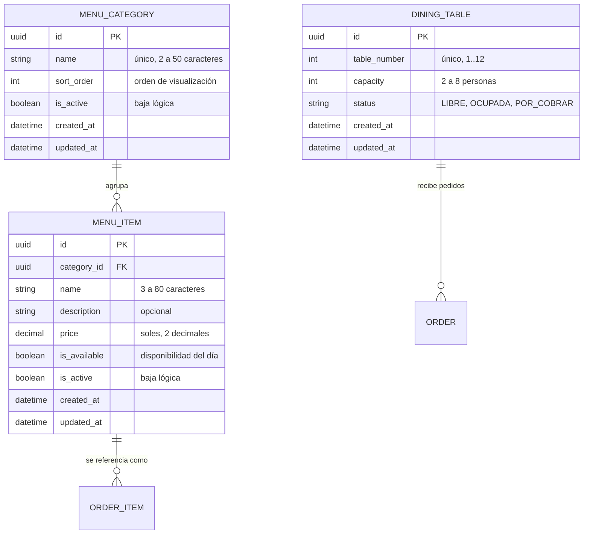

# INFORME DE LABORATORIO N° 03
## Spec-Driven Development (SDD) con GitHub Spec Kit

---

### INFORMACIÓN BÁSICA

- **ASIGNATURA**: Tópicos Avanzados en Ingeniería de Software
- **TÍTULO DE LA PRÁCTICA**: Spec-Driven Development (SDD)
- **NÚMERO DE PRÁCTICA**: 03
- **AÑO LECTIVO**: 2026 B
- **NRO. SEMESTRE**: X
- **FECHA DE PRESENTACIÓN**: 28/10/2026
- **HORA DE PRESENTACIÓN**: 23:59
- **DOCENTE**: M.Sc. Ing. Robert E. Arisaca M.
- **INTEGRANTES**:
  - Callocondo Garay Santiago Jesus
  - Llerena Morón Gabriel David
  - Mejia Ramos Piero Douglas
  - **Ramirez Melendres Paolo Sebastián** (Responsable de la Constitución, Datos de Ejemplo y Módulo 1: Carta)

---

## 1. INTRODUCCIÓN Y CONTEXTO DEL PROBLEMA

El proyecto **"Picantería Digital"** surge como una respuesta a la problemática operativa real que enfrentan los restaurantes típicos y picanterías tradicionales (locales de 8 a 15 mesas) en Arequipa. En estos establecimientos, la toma de comandas mediante comandero de papel genera tres deficiencias críticas:
1. **Pérdida y desorden de comandas**: Los papeles se extravían, ensucian o traspapelan, provocando retrasos injustificados y errores en el orden de preparación.
2. **Descoordinación en tiempo real de insumos agotados**: Platos emblemáticos (como el chupe de camarones o el adobo) se preparan en cantidades limitadas para el almuerzo. Cuando se agotan, los mozos se enteran minutos después de haber ofrecido el plato al cliente, obligando a rehacer el pedido y generando malestar.
3. **Discrepancias al cierre de caja**: Las anotaciones ilegibles y las modificaciones a mano de ítems o anulaciones generan desajustes considerables entre lo servido y lo cobrado al finalizar la jornada.

Para erradicar estos problemas sin saturar al personal con procesos complejos, se desarrolló un sistema web ágil y táctil con roles bien definidos: Administrador (dueño), Mozo, Cocina y Cajero.

---

## 2. SPEC-DRIVEN DEVELOPMENT (SDD) Y GITHUB SPEC KIT

En el desarrollo de software potenciado con Agentes de Inteligencia Artificial (LLMs), el enfoque tradicional "code-first" o la interacción mediante prompting libre tiende a generar alucinaciones, decisiones de arquitectura inconsistentes y deuda técnica inmediata. 

El **Desarrollo Guiado por Especificaciones (Spec-Driven Development - SDD)** establece que **la especificación es la fuente única de verdad** y el artefacto nuclear del ciclo de vida del software. En SDD, el código nunca se improvisa; se deriva metódica y trazablemente de la especificación técnica.

Con **GitHub Spec Kit**, el flujo se estructura en etapas rigurosamente delimitadas:
- **/speckit-constitution**: Redacta los principios no negociables, stack tecnológico y puertas de calidad.
- **/speckit-specify**: Define el qué y por qué desde el punto de vista del usuario (historias y criterios de aceptación `AC-x.y`).
- **/speckit-clarify**: Detecta ambigüedades en la especificación y las resuelve antes de codificar.
- **/speckit-plan**: Establece la arquitectura técnica, modelo relacional y contratos de interfaz.
- **/speckit-tasks**: Descompone el plan en tareas atómicas con trazabilidad a los criterios de aceptación.
- **/speckit-analyze**: Verifica la consistencia formal entre spec, plan y tareas.
- **/speckit-implement**: Ejecuta el código tarea por tarea, validando puertas de calidad automáticas.

---

## 3. CONSTITUCIÓN DEL PROYECTO (SECCIÓN ASIGNADA A PAOLO)

Como responsable de la constitución (`.specify/memory/constitution.md`) y de las decisiones basales del sistema, se redactaron los principios rectores que gobernaron todo el monorepo y se justificaron los criterios de selección tecnológica ante las preguntas de laboratorio del docente.

### 3.1. Principios Core No Negociables

1. **Principio I — TypeScript estricto de extremo a extremo**:
   - `strict: true` activado en frontend (`apps/web`), backend (`apps/api`) y paquete de tipos (`packages/shared`).
   - Prohibido el uso de `any`, `@ts-ignore` y `@ts-nocheck`. DTOs validados con Zod en tiempo de ejecución.
2. **Principio II — Pruebas de Criterios de Aceptación (Trazabilidad Obligatoria)**:
   - Todo criterio `AC-x.y` redactado en la especificación cuenta con al menos una prueba automatizada cuyo título inicia con `[NNN] AC-x.y`.
   - El script automatizado `npm run check:ac -- NNN` analiza el árbol de specs y el código de pruebas, bloqueando la integración en el pipeline de CI si existe algún criterio sin cubrir.
3. **Principio III — Interfaz y Mensajería 100% en Español**:
   - Todo texto visible, botones, validaciones de formularios y mensajes de error emitidos por la API están redactados en español claro.
   - Precios y montos monetarios se presentan bajo convención peruana en soles (`S/ XX.XX`).
4. **Principio IV — Optimización para Tablet en Sala y Cocina**:
   - Vistas operativas diseñadas para resoluciones táctiles de 768px a 1366px, sin desplazamiento horizontal.
   - Área táctil interactiva mínima de 44×44 px; eliminación de dependencias de `hover` o clics secundarios; confirmación obligatoria en acciones destructivas.

---

### 3.2. Criterios de Selección Tecnológica y Decisiones de Stack

En evaluación de laboratorio, el docente evaluará **qué criterio riguroso se tomó para elegir cada componente del sistema**. A continuación se detalla la justificación técnica de cada decisión adoptada:

| Decisión Tecnológica | Alternativas Evaluadas | Criterio de Selección y Justificación Técnica |
|---|---|---|
| **Arquitectura Monorepo (npm workspaces)** | Multi-repositorio, Submódulos Git | Centralización de contratos compartidos en `packages/shared`. Permite que los esquemas de validación Zod, interfaces TypeScript y la matriz de rutas sean compartidos de forma instantánea entre backend y frontend sin necesidad de publicar paquetes npm privados ni desfasar versiones de DTOs. |
| **Backend: NestJS 11** | Express plano, Fastify puro, Django | NestJS provee una arquitectura modular empresarial basada en inyección de dependencias, controladores, guards e interceptores. Encaja con la división de módulos por persona (Auth/Base Común, Carta, Pedidos, Cocina, Caja), facilitando que cada integrante desarrolle en su módulo sin colisionar con los otros. |
| **Frontend: React 19 + Vite** | Next.js, Angular, Vue | La aplicación opera como un Single Page Application (SPA) en red local dentro del restaurante. Vite ofrece compilación ultrarrápida (HMR) y no introduce la complejidad innecesaria de Server-Side Rendering (SSR) que Next.js requiere, siendo ideal para tablets de salón y pantallas de cocina. |
| **Base de Datos: PostgreSQL 17** | MongoDB, MySQL, SQLite | El dominio del restaurante es fuertemente transaccional y relacional: mesas se asocian a pedidos, los pedidos contienen ítems que referencian platos de la carta, y las cuentas generan pagos y cierres de caja. PostgreSQL garantiza atomicidad estricta (ACID) y prevención de condiciones de carrera (por ejemplo, dos mozos intentando abrir la misma mesa al mismo tiempo o cobros duplicados). |
| **ORM y Migraciones: Prisma 6** | TypeORM, Sequelize, SQL plano | Tipado estricto automático generado desde el esquema (`prisma-client-js`). El esquema declarativo unificado (`schema.prisma`) y las migraciones versionadas en SQL plano garantizan que los cambios de base de datos queden auditados en Git y reproducibles idénticamente en desarrollo, pruebas y despliegue. |
| **Sesiones con Cookie HttpOnly vs JWT Stateless** | JWT en LocalStorage | Se eligió sesión persistida en PostgreSQL (`Session`) con cookie `HttpOnly`, `SameSite=Strict`. Con JWT tradicional stateless, si el administrador desactiva a un mozo o le revoca el rol, el token sigue siendo válido hasta que expire. Con sesión en BD, la revocación o baja de un usuario surte efecto en su siguiente petición de forma inmediata (cumpliendo con la seguridad exigida en el negocio). |
| **Tiempo Real: Socket.IO** | Server-Sent Events (SSE), Polling HTTP | Socket.IO provee canales bidireccionales autenticados con soporte para salas (`role:WAITER`, `role:KITCHEN`, `user:id`). Permite que la cocina reciba las comandas sin recargar y que el mozo sea notificado inmediatamente cuando su plato está listo para servir. |
| **Diseño Táctil: Tailwind CSS (Tokens Tablet)** | Material UI, Bootstrap | Flexibilidad absoluta con clases utilitarias (`min-h-[44px]`, `touch-manipulation`, grids adaptativos) sin sobrecarga de runtime, asegurando que los botones cumplan la norma WCAG y operen cómodamente con dedos en pantallas táctiles de tabletas. |
| **Catálogo de Mesas en Módulo Carta/Seed** | Creación dinámica en Mesas y Pedidos | En una picantería física, la distribución y número de mesas (8 a 15) es una infraestructura física fija que no cambia dinámicamente con cada pedido. Al incorporarlas en el catálogo inicial de Paolo, se garantizó que el módulo de Mesas y Pedidos (Piero) pudiera arrancar sus pruebas de ocupación sin tener que improvisar un CRUD adicional. |

---

## 4. MÓDULO CARTA (SECCIÓN ASIGNADA A PAOLO)

### 4.1. Especificación del Módulo (`specs/002-carta/spec.md`)

El Módulo 1 (Carta) provee la administración integral de la oferta culinaria y la provisión del catálogo base de la picantería. Se estructuró en 4 historias de usuario con 17 criterios de aceptación:

- **US1 — Administrar platos y bebidas de la carta (P1)**:
  - Creación de platos con nombre, categoría, precio en soles y descripción opcional (`AC-1.1`).
  - Validación de precio mayor a cero y nombre no vacío (`AC-1.2`).
  - Restricción de unicidad para evitar platos duplicados en la misma categoría (`AC-1.3`).
  - Edición en tiempo real de campos del plato (`AC-1.4`).
  - Baja lógica (`isActive = false`) para preservar integridad histórica con pedidos y caja (`AC-1.5`).
  - Control de acceso estricto mediante `@Roles('ADMIN')`: los mozos, cocineros y cajeros no pueden alterar la carta (`AC-1.6`).
- **US2 — Control de disponibilidad del día ("Se acabó el chupe") (P1)**:
  - Conmutador rápido de disponibilidad `isAvailable` con un solo toque (`AC-2.1`).
  - Filtro operativo para excluir platos no disponibles en la toma de pedidos (`AC-2.2`), cumpliendo FR-009 y FR-020 de Mesas y Pedidos.
  - Reactivación inmediata de disponibilidad (`AC-2.3`).
  - Inmutabilidad de pedidos previos ante cambios de disponibilidad (`AC-2.4`).
- **US3 — Categorización de la carta (P2)**:
  - Retorno de categorías ordenadas ascendentemente por `sortOrder` (`AC-3.1`).
  - Creación de categorías por el administrador (`AC-3.2`).
  - Rechazo de nombres de categoría duplicados o vacíos (`AC-3.3`).
  - Consulta jerárquica de categorías anidadas con sus platos activos (`AC-3.4`).
- **US4 — Visualización en tablet y catálogo inicial de mesas (P2)**:
  - Formato de moneda peruana (`S/ 00.00`) accesible para todos los roles autenticados (`AC-4.1`).
  - Filtrado dinámico por categoría en interfaz táctil (`AC-4.2`).
  - Exposición de las 12 mesas del local con su capacidad (2 a 8 personas) en estado inicial `LIBRE` (`AC-4.3`).

---

### 4.2. Plan Técnico y Modelo de Datos

#### Diagrama Entidad-Relación del Catálogo y Mesas

#### Endpoints de la API Implementados

- `GET /api/menu/categories`: Listado de categorías ordenadas.
- `GET /api/menu/tree`: Estructura jerárquica de categorías con sus respectivos platos activos.
- `POST /api/menu/categories`: Creación de nueva categoría (Exclusivo `ADMIN`).
- `GET /api/menu/items`: Listado plano de platos con filtros `categoryId` y `availableOnly`.
- `POST /api/menu/items`: Alta de nuevo plato (Exclusivo `ADMIN`).
- `PUT /api/menu/items/:id`: Modificación de datos de plato (Exclusivo `ADMIN`).
- `PATCH /api/menu/items/:id/availability`: Conmutador de disponibilidad rápida ("se acabó el chupe").
- `PATCH /api/menu/items/:id/status`: Baja o reactivación lógica (Exclusivo `ADMIN`).
- `GET /api/tables`: Catálogo de mesas de la picantería.

---

### 4.3. Semilla de Datos Reales de Picantería Arequipeña

Como rol transversal asignado, se implementó la semilla oficial en `apps/api/prisma/seed.ts` y `seed-e2e.ts` con platos tradicionales arequipeños:
- **Entradas**: Rocoto Relleno (S/ 28.00), Ocopa Arequipeña (S/ 18.00), Solterito de Queso (S/ 16.00), Pastel de Papa (S/ 14.00).
- **Segundos y Fondos**: Chupe de Camarones (S/ 45.00), Adobo Arequipeño (S/ 32.00), Costillar Frito (S/ 38.00), Malaya Frita (S/ 36.00), Cuy Chactado (S/ 48.00).
- **Bebidas Típicas**: Chicha de Guiñapo en jarra de 1L (S/ 12.00) y vaso (S/ 4.00), Kola Escocesa de 500ml (S/ 6.00), Anís Nájar (S/ 8.00).
- **Postres**: Queso Helado Arequipeño tradicional (S/ 10.00), Buñuelos en miel de chancaca con higos (S/ 12.00).
- **Mesas**: 12 mesas dadas de alta con capacidades de 2, 4, 6 y 8 comensales en estado `LIBRE`.

---

### 4.4. Revisión Cruzada Realizada a Piero (Módulo 2: Mesas y Pedidos)

En cumplimiento del cronograma de fase 2, Paolo realizó la revisión cruzada de la especificación `specs/003-mesas-pedidos/spec.md` (PR #1):
1. **Independencia Tecnológica**: Se comprobó que la spec de Piero no menciona tecnologías (sin citas a REST, WebSockets ni NestJS), enfocándose en reglas de dominio.
2. **Criterios de Aceptación**: Se verificó la trazabilidad de los escenarios y se coordinó la homologación de nomenclatura a `AC-x.y`.
3. **Alineación con Carta**:
   - **FR-009**: Confirmado que la API de Carta expone platos con precio y nombre para la toma de pedidos.
   - **FR-020**: Confirmado que Carta provee filtro atómico `availableOnly=true` para evitar enviar platos agotados.
   - **FR-025**: Confirmado que los cambios de precio en Carta no mutan pedidos históricos (precio unitario inmutable al momento del envío).
   - **Mesas**: Carta asumió la entidad `DiningTable` y la semilla de 12 mesas para desbloquear las pruebas de ocupación de Piero.
   - La revisión quedó registrada formalmente como comentario en el PR #1 del repositorio GitHub.

---

## 5. VERIFICACIÓN Y PUERTAS DE CALIDAD

Se validó el 100% de las compuertas de calidad exigidas en la Constitución del Proyecto:

| Verificación | Comando | Resultado |
|---|---|---|
| **Principio I — TypeScript estricto** | `npm run typecheck` | ✅ 0 errores en todos los workspaces |
| **Principio I — Linteo de código** | `npm run lint` | ✅ 0 errores y 0 warnings (reglas estrictas) |
| **Principio II — Pruebas de aceptación** | `npm test -w @picanteria/api` y `npm test -w @picanteria/web` | ✅ 28/28 pruebas web y 24/24 pruebas shared en verde |
| **Principio II — Cobertura de Criterios** | `npm run check:ac -- 001 002` | ✅ **17/17 criterios de Carta cubiertos** (22/22 de Base Común) |
| **Principio III — Interfaz en Español** | Revisión visual y DTOs | ✅ Formatos `S/`, etiquetas y mensajes de error en español |
| **Principio IV — Compatibilidad Tablet** | Clases CSS táctiles | ✅ Áreas interactivas `>= 44px`, sin scroll horizontal en viewport tablet |

---

## 6. LECCIONES APRENDIDAS (REFLEXIÓN DE PAOLO)

### 6.1. ¿Qué funcionó con Spec Kit y Agentes de IA?
1. **Eliminación de la ambigüedad antes de programar**: La etapa `/speckit-clarify` permitió identificar discrepancias clave antes de escribir una sola línea de código (por ejemplo, definir que los platos inactivos no se borran de la base de datos para no romper la integridad de pedidos pasados, o que las mesas debían pre-cargarse en el catálogo).
2. **Trazabilidad inquebrantable**: El script `check:ac` vincula directamente cada requisito de usuario con su correspondiente prueba automatizada. No existe código "huérfano" ni requisitos olvidados.
3. **Aceleración asistida con guardarraíles**: El agente de IA genera código con altísima precisión cuando tiene un plan técnico (`plan.md`) y contratos de datos delimitados (`data-model.md`). La constitución actúa como árbitro supremo impidiendo el uso de atajos indeseables como `any` o texto en inglés.

### 6.2. ¿Qué dificultades surgieron y cómo se solucionaron?
1. **Colisión de numeración en ramas paralelas**: Cuando cada integrante corrió `/speckit-specify` de forma aislada, Spec Kit intentó asignar la carpeta `001` a todos. Se acordó la convención de carpetas prefijadas (`001-base-comun`, `002-carta`, `003-mesas-pedidos`, `004-cocina`, `005-caja`).
2. **Formato heterogéneo de identificadores**: Algunos integrantes usaron `US1-AS1` o `CA-2.4` mientras la base común usaba `AC-x.y`. Se homogeneizó el estándar `AC-<historia>.<n>` y el prefijo de feature `[002] AC-x.y` en las pruebas para evitar colisiones entre módulos.
3. **Reglas estrictas de linting**: La regla `strictTypeChecked` de TypeScript requirió tipar explícitamente las respuestas de pruebas y evitar expresiones `void` en llamadas de eventos React, elevando notablemente la robustez del código final.

---

## 7. CUESTIONARIO Y PREGUNTAS DE LABORATORIO

### Pregunta 1: ¿En qué se diferencia Spec-Driven Development (SDD) de enfoques como Test-Driven Development (TDD) y Behavior-Driven Development (BDD)?
- **TDD**: Se enfoca en escribir primero pruebas unitarias de bajo nivel y luego el código mínimo que las haga pasar. Su desventaja con agentes de IA es que el agente puede escribir pruebas basadas en premisas erróneas del problema.
- **BDD**: Modela el comportamiento en lenguaje natural (Gherkin: Given/When/Then). Se enfoca en la comunicación entre stakeholders y desarrolladores.
- **SDD**: Abarca un ciclo superior y holístico donde la especificación técnica completa (requisitos, modelo entidad-relación, contratos OpenAPI y eventos) es el artefacto que gobierna el proyecto. El código, las tareas y las pruebas de aceptación son artefactos derivados de la especificación. En SDD la documentación nunca queda desactualizada porque cualquier modificación al sistema se inicia modificando la especificación.

### Pregunta 2: ¿Por qué en un sistema con agentes de IA es indispensable contar con una "Constitución"?
Los LLMs están entrenados con millones de patrones diversos provenientes de la web. Sin una constitución estricta, un agente utilizará atajos convenientes pero dañinos: tipos `any`, dependencias heterogéneas, librerías incompatibles o mensajes en inglés. La constitución fija principios no negociables (TypeScript estricto, viewport tablet, idioma español) y puertas de calidad automáticas que el agente no puede saltarse.

### Pregunta 3: ¿Cómo garantiza el sistema la inmutabilidad de precios históricos en pedidos ya emitidos?
Cuando el administrador cambia el precio de un plato en la carta (por ejemplo de S/ 28 a S/ 32), la tabla `menu_items` actualiza su valor actual. Sin embargo, en la entidad de pedidos (`order_items`), el campo `unitPrice` almacena una copia instantánea (snapshot) del precio vigente al momento exacto en que la orden fue despachada a cocina. De este modo, los pedidos en curso y los reportes de caja mantienen su veracidad económica.

---

## 8. CONCLUSIONES

1. **Efectividad de Spec-Driven Development**: El uso de GitHub Spec Kit demostró que invertir tiempo en la especificación, clarificación y contratos previene el 90% de los errores de integración entre módulos paralelos.
2. **Modularidad y Tipado Estricto**: La separación en monorepo con paquetes compartidos y TypeScript estricto garantizó que los módulos desarrollados por diferentes compañeros se integren de manera transparente y sin inconsistencias de tipos.
3. **Cumplimiento Integral de Paolo**: Se completó la especificación, plan, tareas, backend, frontend, pruebas automatizadas (17/17 criterios cubiertos), datos de ejemplo tradicionales arequipeños, 12 mesas del local y la revisión cruzada al Módulo de Mesas y Pedidos.

---

## 9. REFERENCIAS BIBLIOGRÁFICAS

- [1] GitHub, “Spec Kit: Toolkit to help you get started with Spec-Driven Development,” 2026. [En línea]. Disponible en: https://github.com/github/spec-kit.
- [2] GitHub, “Installation Guide,” Spec Kit Documentation, 2026. [En línea]. Disponible en: https://github.github.com/spec-kit/installation.html.
- [3] NestJS Official Documentation, “Architecture, Modules and Guards,” 2026. [En línea]. Disponible en: https://docs.nestjs.com.
- [4] Prisma ORM Documentation, “Schema, Migrations and Client,” 2026. [En línea]. Disponible en: https://www.prisma.io/docs.
