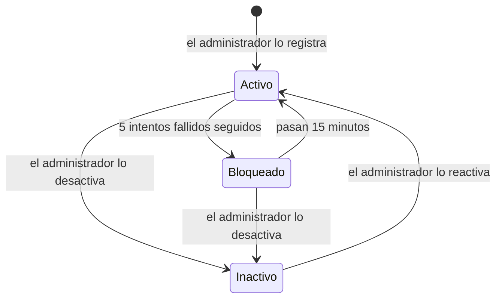
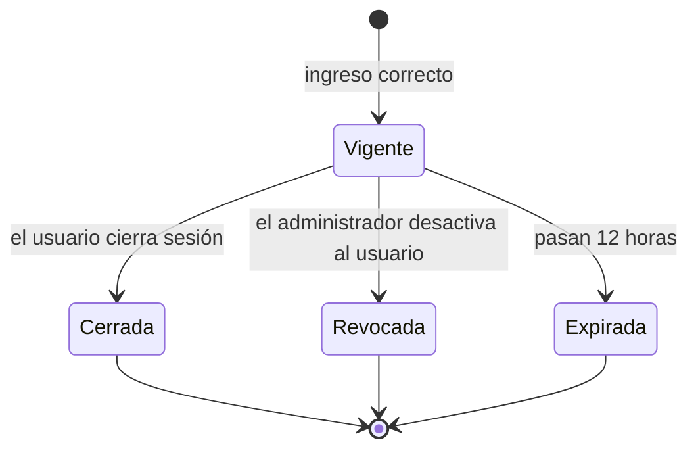

# Data Model: Base común — inicio de sesión, roles y gestión de usuarios

**Feature**: [spec.md](spec.md) | **Plan**: [plan.md](plan.md) | **Date**: 2026-10-28

Este documento tiene dos partes:

1. **Modelo general del sistema**: diagrama entidad-relación de todos los dominios (auth,
   menu, orders, kitchen, billing), para que las features posteriores partan de una visión
   común.
2. **Detalle de esta feature**: las entidades que esta feature implementa (`User`, `Session`)
   con campos, reglas de validación y transiciones de estado.

Los identificadores de código (tablas, campos, enums) están en inglés; las etiquetas visibles
para el usuario se traducen en la interfaz (Principio III).

## 1. Modelo general del sistema

> Las entidades marcadas como **provisionales** solo fijan la estructura general y sus
> relaciones. Sus campos definitivos se precisarán en la especificación y el plan de la feature
> que las implemente (menú, pedidos, cocina, caja). Solo `User` y `Session` se implementan en
> esta feature.

```mermaid
erDiagram
    USER ||--o{ SESSION : "inicia"
    USER ||--o{ ORDER : "registra (mozo)"
    USER ||--o{ BILL : "emite (cajero)"
    MENU_CATEGORY ||--o{ MENU_ITEM : "agrupa"
    DINING_TABLE ||--o{ ORDER : "recibe"
    ORDER ||--|{ ORDER_ITEM : "contiene"
    MENU_ITEM ||--o{ ORDER_ITEM : "se pide como"
    ORDER ||--o| BILL : "se cobra con"
    BILL ||--|{ PAYMENT : "se paga con"

    USER {
        uuid id PK
        string fullName
        string username UK "minúsculas"
        string passwordHash
        enum role "ADMIN | WAITER | KITCHEN | CASHIER"
        boolean isActive
        int failedLoginAttempts
        datetime lockedUntil "nullable"
        datetime createdAt
        datetime updatedAt
    }

    SESSION {
        uuid id PK
        uuid userId FK
        string tokenHash UK "SHA-256 del token"
        datetime createdAt
        datetime expiresAt
        datetime revokedAt "nullable"
        string userAgent "nullable"
    }

    MENU_CATEGORY {
        uuid id PK "provisional"
        string name
        int sortOrder
        boolean isActive
    }

    MENU_ITEM {
        uuid id PK "provisional"
        uuid categoryId FK
        string name
        string description "nullable"
        decimal price "soles, 2 decimales"
        boolean isAvailable
    }

    DINING_TABLE {
        uuid id PK "provisional"
        int number UK
        int capacity
        boolean isActive
    }

    ORDER {
        uuid id PK "provisional"
        uuid tableId FK
        uuid waiterId FK "USER con rol WAITER o ADMIN"
        enum status "OPEN | SENT | READY | SERVED | PAID | CANCELLED"
        string notes "nullable"
        datetime createdAt
        datetime updatedAt
    }

    ORDER_ITEM {
        uuid id PK "provisional"
        uuid orderId FK
        uuid menuItemId FK
        int quantity
        decimal unitPrice "precio al momento del pedido"
        string notes "nullable"
        enum status "PENDING | PREPARING | READY | SERVED | CANCELLED"
    }

    BILL {
        uuid id PK "provisional"
        uuid orderId FK, UK
        uuid cashierId FK "USER con rol CASHIER o ADMIN"
        decimal total
        enum status "OPEN | PAID | VOID"
        datetime issuedAt
    }

    PAYMENT {
        uuid id PK "provisional"
        uuid billId FK
        enum method "CASH | CARD | DIGITAL_WALLET"
        decimal amount
        datetime paidAt
    }
```

### Correspondencia con los módulos del backend

| Módulo | Entidades que posee | Notas |
|--------|--------------------|-------|
| `auth` | `USER`, `SESSION` | Incluye la gestión de usuarios del administrador. **Esta feature.** |
| `menu` | `MENU_CATEGORY`, `MENU_ITEM` | Carta y disponibilidad de platos. |
| `orders` | `DINING_TABLE`, `ORDER`, `ORDER_ITEM` | Toma de pedidos del mozo. |
| `kitchen` | — (opera sobre `ORDER_ITEM.status`) | Vista de cocina; cambia el estado de preparación y notifica por Socket.IO. |
| `billing` | `BILL`, `PAYMENT` | Cobro en caja. |

**Decisiones del modelo general**:

- `ORDER_ITEM.unitPrice` copia el precio del plato al momento del pedido, para que un cambio de
  precio en la carta no altere pedidos ya registrados.
- Los usuarios nunca se eliminan (FR-018): `ORDER.waiterId` y `BILL.cashierId` siempre apuntan
  a un usuario existente, aunque esté inactivo.
- Los montos usan `decimal` con 2 decimales, nunca coma flotante.

## 2. Entidades de esta feature

### Role (enum)

| Valor | Etiqueta en la interfaz | Pantalla inicial |
|-------|-------------------------|------------------|
| `ADMIN` | Administrador | `/admin/usuarios` |
| `WAITER` | Mozo | `/mozo` |
| `KITCHEN` | Cocina | `/cocina` |
| `CASHIER` | Cajero | `/caja` |

Cada usuario tiene exactamente un rol (FR-009). `ADMIN` tiene acceso a todas las pantallas y
operaciones (FR-011). La matriz completa está en [contracts/ui-routes.md](contracts/ui-routes.md).

### User

| Campo | Tipo | Reglas |
|-------|------|--------|
| `id` | UUID | Generado por el sistema. |
| `fullName` | texto | Obligatorio; 2 a 100 caracteres tras quitar espacios en los extremos. |
| `username` | texto, único | Obligatorio; se quitan espacios en los extremos y se guarda en minúsculas; 3 a 30 caracteres de `a-z`, `0-9`, `.`, `-`, `_`. Único (FR-014). |
| `passwordHash` | texto | Hash Argon2id. Nunca se devuelve en ninguna respuesta (FR-021). |
| `role` | `Role` | Obligatorio. |
| `isActive` | booleano | `true` al crear. |
| `failedLoginAttempts` | entero ≥ 0 | Se reinicia a 0 al ingresar con éxito o al vencer el bloqueo. |
| `lockedUntil` | fecha y hora, opcional | Se fija a ahora + 15 min al llegar a 5 fallos (FR-003). |
| `createdAt`, `updatedAt` | fecha y hora | Automáticos. |

**Reglas de validación de entrada** (esquemas Zod en `packages/shared`):

- Contraseña: 8 a 128 caracteres (FR-015).
- Al crear: `fullName`, `username`, `password`, `role` obligatorios.
- Al editar: solo `fullName` y `role` (FR-016). El nombre de usuario no se edita en esta
  versión.

**Invariantes**:

- Siempre existe al menos un usuario con `role = ADMIN` e `isActive = true` (FR-019, AC-3.8).
- Un administrador no puede desactivarse a sí mismo (FR-019).

**Estados del usuario**:

"Bloqueado" no es un valor guardado: se deriva de `lockedUntil > ahora`. Desactivar a un
usuario revoca todas sus sesiones vigentes (AC-3.6).

### Session

| Campo | Tipo | Reglas |
|-------|------|--------|
| `id` | UUID | Generado por el sistema. |
| `userId` | UUID → User | Obligatorio. |
| `tokenHash` | texto, único | SHA-256 del token enviado en la cookie. El token en claro nunca se guarda. |
| `createdAt` | fecha y hora | Momento del ingreso. |
| `expiresAt` | fecha y hora | `createdAt + 12 h` (FR-007). |
| `revokedAt` | fecha y hora, opcional | Se fija al cerrar sesión o al desactivar al usuario. |
| `userAgent` | texto, opcional | Para que el administrador pueda identificar dispositivos en el futuro. |

**Una sesión es válida** si `revokedAt` es nulo, `expiresAt > ahora` y su usuario está
activo. El rol se lee del usuario en cada petición, no de la sesión, para que un cambio de rol
aplique en la siguiente acción (FR-012, AC-2.4).

**Estados de la sesión**:

"Expirada" se deriva de `expiresAt <= ahora`. "Cerrada" y "Revocada" se guardan ambas en
`revokedAt`; la diferencia solo importa para el evento de tiempo real enviado al frontend.

**Índices**: `Session.tokenHash` (único, búsqueda por petición), `Session.userId` (revocar todas
las sesiones de un usuario).
