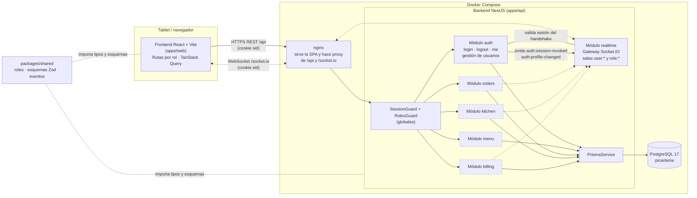

# Implementation Plan: Base común — inicio de sesión, roles y gestión de usuarios

**Branch**: `001-base-comun` | **Date**: 2026-10-28 | **Spec**: [spec.md](spec.md)

**Input**: Feature specification from `/specs/001-base-comun/spec.md`

**Note**: This template is filled in by the `/speckit-plan` command; its definition describes the execution workflow.

## Summary

Esta feature crea la base del sistema: inicio de sesión con usuario y contraseña, cuatro roles
fijos (administrador, mozo, cocina, cajero) con acceso restringido por rol, y la gestión de
usuarios por parte del administrador, que además puede entrar a todas las pantallas.

Enfoque técnico: monorepo con npm workspaces (`apps/web` en React + Vite, `apps/api` en NestJS,
`packages/shared` con roles, esquemas Zod y eventos compartidos). La autenticación usa sesiones
guardadas en PostgreSQL (vía Prisma) y una cookie `HttpOnly`, para que desactivar a un usuario
o cambiar su rol tenga efecto en su siguiente acción. Un canal Socket.IO autenticado con la
misma cookie avisa al instante de esos cambios y queda listo para pedidos y cocina. Todo se
levanta con Docker Compose. Detalle de cada decisión en [research.md](research.md).

## Technical Context

**Language/Version**: TypeScript 5.x en modo estricto; Node.js 22 LTS.

**Primary Dependencies**: NestJS 11, Prisma 6, Socket.IO 4, Zod, Argon2 (api); React 19,
Vite, React Router, TanStack Query, react-hook-form, Tailwind CSS, socket.io-client (web).
Justificación de cada una en [research.md](research.md#resumen-de-dependencias-nuevas).

**Storage**: PostgreSQL 17, esquema y migraciones versionadas con Prisma.

**Testing**: Jest + Supertest contra PostgreSQL real (api); Vitest + React Testing Library +
MSW (web); Playwright en viewports de tablet (extremo a extremo); script de cobertura de
criterios de aceptación.

**Target Platform**: Navegadores modernos en tablet (Android/iPadOS, Chrome y Safari) y en
computadora; servidor Linux en contenedores Docker.

**Project Type**: Aplicación web (SPA + API REST + canal WebSocket) en monorepo.

**Performance Goals**: Ingreso completo en menos de 15 s para el usuario (SC-001), con
respuesta de la API de login en menos de 500 ms (p95) pese al costo de Argon2. Eventos de
tiempo real entregados en menos de 2 s.

**Constraints**: Interfaz 100 % en español; vistas de mozo y cocina utilizables en 768–1366 px
sin desplazamiento horizontal; revocación efectiva en la siguiente petición; ningún secreto en
el repositorio.

**Scale/Scope**: Una picantería: hasta ~30 usuarios registrados y ~15 conectados a la vez. En
esta feature: 6 pantallas (ingreso, sin permiso, usuarios, y los inicios de mozo, cocina y
caja) y 8 endpoints.

## Constitution Check

*GATE: Must pass before Phase 0 research. Re-check after Phase 1 design.*

| Regla de la constitución | Cómo la cumple este plan | Estado |
|--------------------------|--------------------------|--------|
| **I. TypeScript estricto** | `tsconfig.base.json` con `strict` y opciones extra; ESLint `strictTypeChecked` prohíbe `any` y `@ts-ignore`; contratos tipados en `packages/shared`; entradas y variables de entorno validadas con Zod en tiempo de ejecución. | ✅ |
| **II. Pruebas de criterios de aceptación** | Los 22 escenarios `AC-x.y` tienen asignada una capa de prueba (ver tabla abajo); títulos con el ID; `npm run check:ac` falla si alguno no está cubierto. | ✅ |
| **III. Interfaz en español** | Textos de UI y mensajes de error de la API en español; códigos de error estables aparte (`code`); mensajes de validación definidos una vez en los esquemas Zod compartidos; fechas y formatos `es-PE`. | ✅ |
| **IV. Tablet para mozo y cocina** | Pruebas Playwright en 768×1024 y 1366×1024 sobre `/ingresar`, `/mozo` y `/cocina`; tokens Tailwind para áreas táctiles de 44 px y texto de cocina ≥ 18 px; sin dependencias de `hover`; confirmación en acciones destructivas. | ✅ |
| **Stack** | React + NestJS + PostgreSQL; migraciones versionadas con Prisma; secretos en `.env` (solo `.env.example` en el repositorio); bibliotecas nuevas justificadas en research.md. | ✅ |
| **Flujo y puertas de calidad** | Spec → plan → tasks → implementación; las puertas se ejecutan con `typecheck`, `lint`, `test`, `test:e2e` y `check:ac` ([quickstart.md](quickstart.md)). | ✅ |

**Resultado previo a Phase 0**: sin violaciones.
**Re-evaluación tras Phase 1**: el diseño (sesiones en base de datos, matriz de rutas
compartida, contratos con mensajes en español, pruebas Playwright de tablet) mantiene todas
las reglas en ✅. Sin violaciones que justificar.

### Asignación de criterios de aceptación a capas de prueba

| Criterios | Capa | Ubicación prevista |
|-----------|------|--------------------|
| AC-1.1 a AC-1.6 | API (Jest + Supertest) | `apps/api/test/acceptance/auth.acceptance.spec.ts` |
| AC-1.7, AC-1.5 (navegador) | Extremo a extremo (Playwright) | `apps/web/e2e/login.spec.ts` |
| AC-2.1, AC-2.2, AC-2.5, AC-2.6 | Extremo a extremo (Playwright) | `apps/web/e2e/role-access.spec.ts` |
| AC-2.3, AC-2.4 | API (Jest + Supertest) | `apps/api/test/acceptance/role-access.acceptance.spec.ts` |
| AC-3.1 a AC-3.8 | API (Jest + Supertest) | `apps/api/test/acceptance/users.acceptance.spec.ts` |
| AC-3.9, AC-3.6 (diálogo de confirmación) | Extremo a extremo (Playwright) | `apps/web/e2e/users-admin.spec.ts` |

Un criterio puede tener pruebas en más de una capa; `check:ac` exige al menos una.

## Architecture

Diagrama de componentes del sistema completo. Los elementos con borde continuo se construyen
en esta feature; los de borde discontinuo llegarán con features posteriores.



**Flujo de una petición autenticada**: el navegador envía la cookie `sid` → nginx la reenvía a
la API → `SessionGuard` busca la sesión por el hash del token, comprueba que no esté revocada
ni expirada, carga el usuario y rechaza si está inactivo → `RolesGuard` compara el rol con el
decorador `@Roles` del endpoint (`ADMIN` siempre pasa) → el controlador del módulo atiende la
petición.

**Flujo del canal de tiempo real**: al conectarse, el gateway valida la cookie con el mismo
servicio de sesiones del módulo `auth` y une el socket a `user:<id>` y `role:<ROL>`. Cuando el
administrador desactiva a un usuario o le cambia el rol, `auth` emite el evento a la sala del
usuario a través de `realtime` ([contracts/websocket-events.md](contracts/websocket-events.md)).

**Módulos**: los cinco módulos de dominio (`auth`, `menu`, `orders`, `kitchen`, `billing`) se
complementan con dos módulos de infraestructura sin lógica de negocio: `realtime` (gateway
Socket.IO compartido) y `prisma` (acceso a datos). La gestión de usuarios vive dentro de `auth`
porque el usuario y su rol son el núcleo de ese dominio.

## Project Structure

### Documentation (this feature)

```text
specs/001-base-comun/
├── plan.md              # Este archivo
├── research.md          # Phase 0: decisiones técnicas
├── data-model.md        # Phase 1: modelo general (ER) y entidades de la feature
├── quickstart.md        # Phase 1: guía de validación
├── contracts/
│   ├── rest-api.yaml        # OpenAPI de auth y users
│   ├── websocket-events.md  # Eventos Socket.IO
│   └── ui-routes.md         # Rutas y matriz de acceso por rol
├── checklists/
│   └── requirements.md  # Calidad de la especificación
└── tasks.md             # Phase 2 (/speckit-tasks; no lo crea este comando)
```

### Source Code (repository root)

```text
package.json                 # npm workspaces + scripts raíz (typecheck, lint, test, check:ac)
tsconfig.base.json           # Opciones estrictas compartidas
eslint.config.mjs
docker-compose.yml           # db, api, web
.env.example
docker/
├── nginx.conf               # SPA + proxy /api y /socket.io
└── postgres-init.sql        # Crea picanteria y picanteria_test
scripts/
└── check-ac-coverage.ts     # IDs AC de spec.md vs. títulos de pruebas

packages/shared/
└── src/
    ├── roles.ts             # Role, ROLE_LABELS, ROLE_HOME, ROUTE_ACCESS
    ├── errors.ts            # Códigos de error y mensajes en español
    ├── events.ts            # Nombres y cargas de eventos Socket.IO
    └── schemas/
        ├── auth.ts          # LoginRequest, CurrentUser
        └── users.ts         # CreateUser, UpdateUser, SetPassword, SetStatus, User

apps/api/
├── Dockerfile
├── prisma/
│   ├── schema.prisma        # User, Session, enum Role
│   ├── migrations/
│   └── seed.ts              # Administrador inicial desde el entorno
├── src/
│   ├── main.ts
│   ├── app.module.ts
│   ├── config/              # Validación Zod de variables de entorno
│   ├── common/              # ZodValidationPipe, filtro de errores, guard CSRF
│   ├── prisma/              # PrismaModule, PrismaService
│   ├── auth/
│   │   ├── auth.module.ts
│   │   ├── auth.controller.ts       # /auth/login, /auth/logout, /auth/me
│   │   ├── users.controller.ts      # /users (solo ADMIN)
│   │   ├── auth.service.ts          # Ingreso, bloqueo, cierre
│   │   ├── users.service.ts         # Alta, edición, contraseña, estado, último admin
│   │   ├── sessions.service.ts      # Crear, validar, revocar sesiones
│   │   ├── password.service.ts      # Argon2id
│   │   ├── guards/                  # session.guard.ts, roles.guard.ts
│   │   └── decorators/              # @Public, @Roles, @CurrentUser
│   └── realtime/
│       ├── realtime.module.ts
│       └── realtime.gateway.ts      # Handshake con cookie, salas, emisión
└── test/
    ├── acceptance/          # auth, role-access, users (*.acceptance.spec.ts)
    └── helpers/             # Reinicio de base de pruebas, fábricas de usuarios

apps/web/
├── Dockerfile               # Build de Vite + nginx
├── index.html
├── vite.config.ts           # Proxy /api y /socket.io en desarrollo
├── src/
│   ├── main.tsx
│   ├── app/                 # router.tsx, providers.tsx, AppShell, NavMenu
│   ├── lib/                 # api-client.ts (cabecera CSRF, errores), socket.ts
│   ├── features/
│   │   ├── auth/            # LoginPage, useCurrentUser, RequireRole, ForbiddenPage
│   │   ├── users/           # UsersPage, UserForm, PasswordDialog, ConfirmDialog
│   │   └── role-home/       # WaiterHome, KitchenHome, CashierHome
│   └── styles/              # Tailwind y tokens de tablet
├── tests/                   # Vitest + Testing Library + MSW
└── e2e/                     # Playwright: login, role-access, users-admin
```

**Structure Decision**: monorepo de aplicación web con dos apps y un paquete compartido.
`apps/api` contiene solo los módulos `auth`, `realtime` y `prisma` en esta feature; los módulos
`menu`, `orders`, `kitchen` y `billing` se crearán como carpetas hermanas de `auth` en sus
propias features, siguiendo el mismo patrón (módulo, controlador, servicio, pruebas de
aceptación).

## Complexity Tracking

No hay violaciones de la constitución que justificar.
