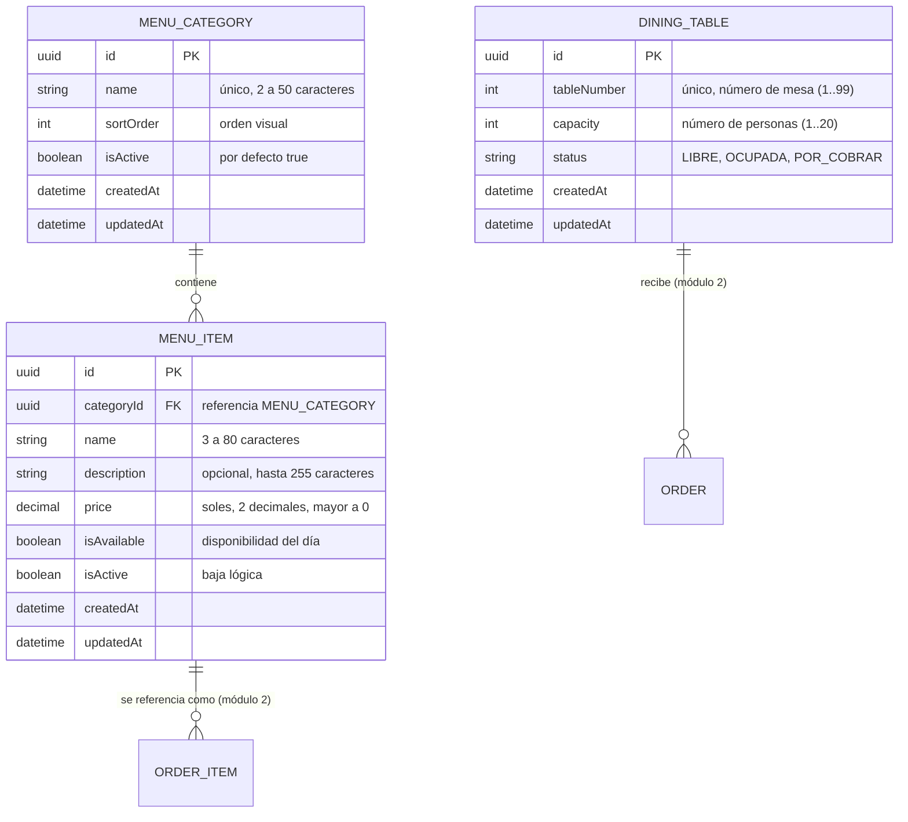

# Data Model: Módulo Carta y Catálogo de Mesas

**Feature**: `002-carta`

Este documento define las entidades gestionadas por el módulo de Carta, junto con el catálogo de mesas asumido según acuerdo del equipo.

## Reglas de Integridad

1. **Unicidad de categoría**: El nombre de categoría es único (case-insensitive) para evitar categorías repetidas.
2. **Unicidad de plato por categoría**: No pueden existir dos platos activos con el mismo nombre dentro de la misma categoría.
3. **Baja lógica**: Los platos y categorías nunca se eliminan físicamente mediante `DELETE` para mantener la integridad referencial histórica con comandas y ventas de cocina/caja. Se marcan con `isActive = false`.
4. **Disponibilidad dinámica (`isAvailable`)**: Modificable en tiempo real. Un plato inactivo (`isActive = false`) no puede figurar como disponible.
5. **Catálogo de Mesas**: Cada mesa tiene un `tableNumber` único y su estado por defecto es `LIBRE`.
