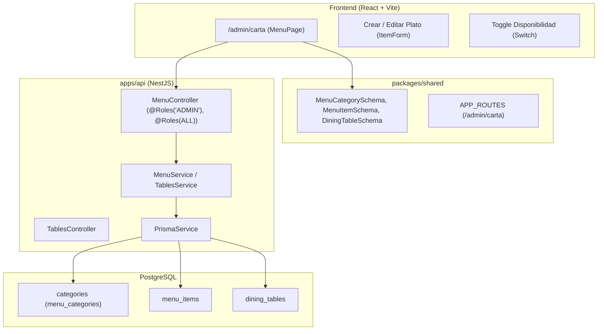

# Implementation Plan: Módulo Carta — Platos, Categorías, Disponibilidad y Catálogo de Mesas

**Branch**: `002-carta` | **Date**: 2026-10-28 | **Spec**: [spec.md](spec.md)

**Input**: Feature specification from `specs/002-carta/spec.md`

## Summary

Este módulo implementa el catálogo central de la picantería:
1. CRUD de platos y bebidas con nombre, descripción, precio en soles (`S/`) y categoría.
2. Gestión de categorías ordenadas (Entradas, Fondos, Bebidas, Postres).
3. Conmutador instantáneo de disponibilidad del día ("Se acabó el chupe") para que los platos agotados no se ofrezcan en pedidos (cumpliendo FR-009 y FR-020).
4. Catálogo y datos iniciales de mesas (12 mesas con capacidades de 2 a 8 personas) en estado libre.

El enfoque técnico se integra de forma nativa en la arquitectura monorepo establecida en `001-base-comun`:
- Backend NestJS: módulo `MenuModule` (`apps/api/src/menu/`) y migración Prisma agregando `MenuCategory`, `MenuItem` y `DiningTable`.
- Paquete compartido: esquemas Zod de validación y tipos TypeScript en `packages/shared/src/schemas/menu.ts` y registro de la ruta `/admin/carta` en `APP_ROUTES`.
- Frontend React: pantalla de gestión de carta en `apps/web/src/features/menu/` con soporte tablet y formularios accesibles.
- Semilla de datos: `apps/api/prisma/seed.ts` y `seed-e2e.ts` ampliados con la carta tradicional arequipeña y las mesas.

## Technical Context

**Language/Version**: TypeScript 5.x estricto, Node.js 22 LTS.
**Primary Dependencies**: NestJS 11, Prisma 6, Zod, React 19, Vite, TanStack Query, React Hook Form, Tailwind CSS.
**Storage**: PostgreSQL 17 (vía Prisma ORM con migraciones versionadas).
**Testing**: Jest + Supertest (pruebas de aceptación API), Vitest + React Testing Library (componentes UI), Playwright (tablet e2e), `scripts/check-ac-coverage.ts`.
**Constraints**: Interfaz 100% en español, moneda en soles `S/`, área táctil >= 44px para tablet, protección `@Roles('ADMIN')` para modificaciones.

## Constitution Check

| Regla de la constitución | Cómo la cumple este plan | Estado |
|---|---|---|
| **I. TypeScript estricto** | Todo el código con `strict: true`. Sin `any` ni `@ts-ignore`. DTOs tipados compartidos con Zod. | ✅ |
| **II. Pruebas de criterios de aceptación** | Los 17 escenarios `AC-x.y` tienen pruebas automatizadas con títulos `[002] AC-x.y`. Verificados por `check:ac`. | ✅ |
| **III. Interfaz en español** | Textos, mensajes de validación y respuestas API en español. Moneda formateada en `S/`. | ✅ |
| **IV. Tablet para mozo y cocina** | Vistas y componentes con áreas táctiles mínimas de 44px, sin dependencias de hover. | ✅ |
| **Stack y puertas de calidad** | Respeta el stack React + NestJS + PostgreSQL + Prisma. Migración versionada en git. | ✅ |

### Asignación de criterios de aceptación a capas de prueba

| Criterios | Capa | Ubicación prevista |
|---|---|---|
| AC-1.1, AC-1.2, AC-1.3, AC-1.4, AC-1.5, AC-1.6 | API (Jest + Supertest) | `apps/api/test/acceptance/menu.acceptance.spec.ts` |
| AC-2.1, AC-2.2, AC-2.3, AC-2.4 | API (Jest + Supertest) | `apps/api/test/acceptance/menu.acceptance.spec.ts` |
| AC-3.1, AC-3.2, AC-3.3, AC-3.4 | API (Jest + Supertest) | `apps/api/test/acceptance/menu.acceptance.spec.ts` |
| AC-4.1, AC-4.2, AC-4.3 | API y Componentes / E2E | `apps/api/test/acceptance/menu.acceptance.spec.ts` y `apps/web/src/features/menu/MenuPage.test.tsx` |

## Architecture & Data Flow

