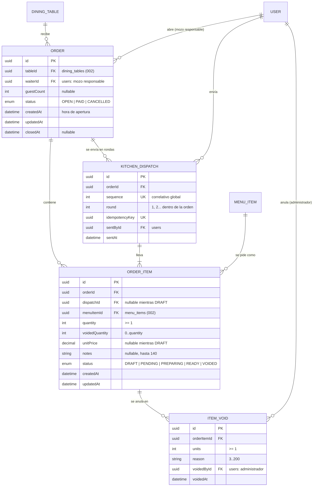
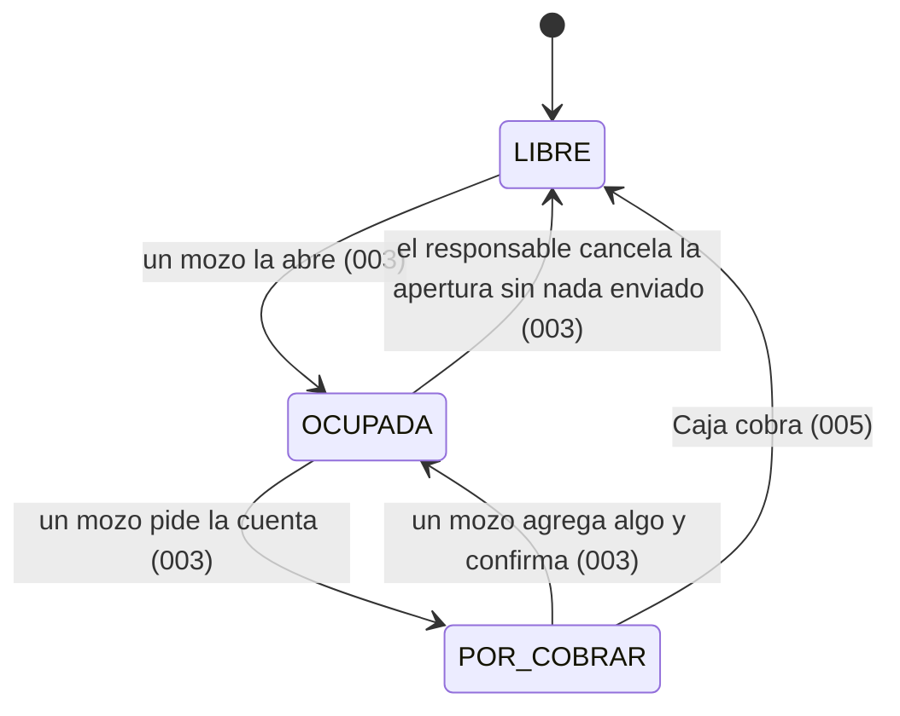
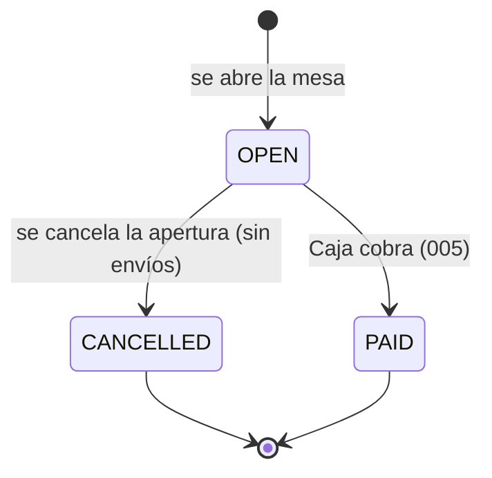
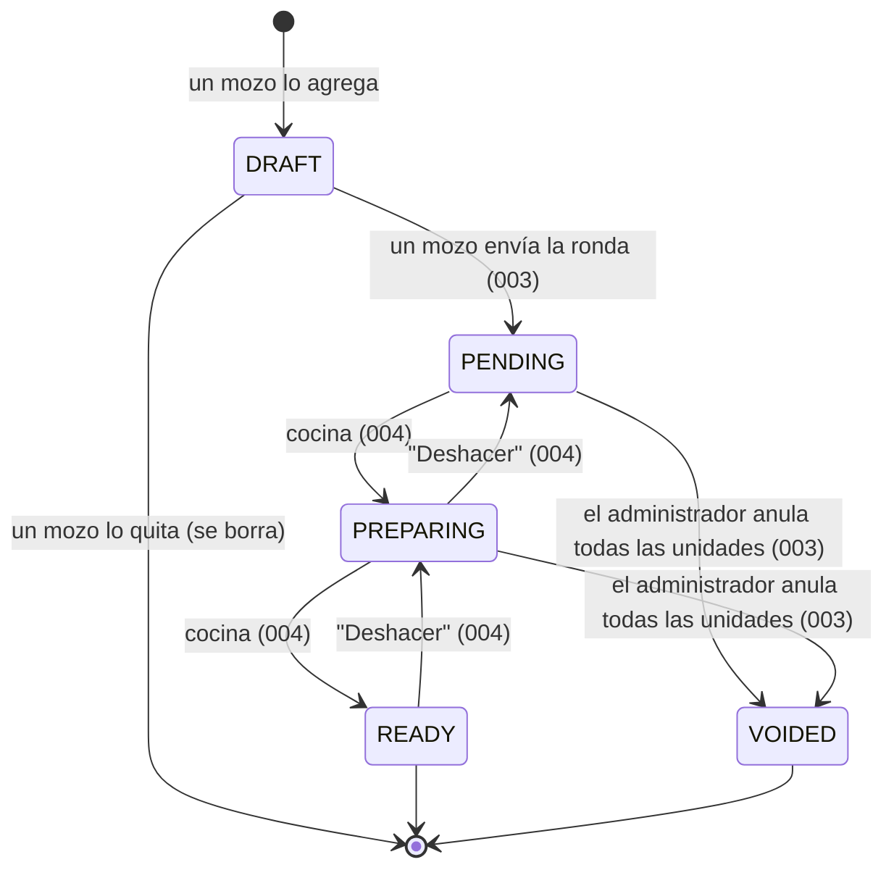

# Data Model: Mesas y pedidos (Módulo 2)

**Feature**: [spec.md](spec.md) | **Plan**: [plan.md](plan.md) | **Date**: 2026-10-29

Este documento define las cuatro entidades que crea la 003 (`Order`, `OrderItem`,
`KitchenDispatch`, `ItemVoid`) y cómo usa las que ya existen (`DiningTable` y `MenuItem` de la
002, `User` de la 001). Los nombres de campos y estados son los acordados con `004-cocina`
([dependencias-003.md](../004-cocina/contracts/dependencias-003.md) en la rama `004-cocina`).
Prevalece sobre el modelo general de la 001 para estas entidades.

Identificadores de código en inglés; etiquetas visibles en español (Principio III).

## Diagrama

`DINING_TABLE`, `MENU_ITEM` y `USER` ya existen (002 y 001); aquí solo aparecen sus relaciones.

## 1. Entidades de esta feature

### OrderStatus (enum)

| Valor | Significado | Lo pone |
|-------|-------------|---------|
| `OPEN` | La mesa está siendo atendida (ocupada o por cobrar). | 003, al abrir la mesa |
| `PAID` | La cuenta se cobró y la mesa se liberó. | Caja (005) |
| `CANCELLED` | Apertura cancelada sin nada enviado a cocina. | 003 |

"Por cobrar" no es un estado del pedido: es `DiningTable.status = POR_COBRAR` con su pedido
`OPEN`.

### Order (`orders`)

La atención completa de una mesa, desde que se abre hasta que se cobra o se cancela.

| Campo | Tipo | Reglas |
|-------|------|--------|
| `id` | UUID | Generado por el sistema. |
| `tableId` | UUID → `DiningTable` | Obligatorio. |
| `waiterId` | UUID → `User` | El mozo que abrió la mesa: su **responsable** (FR-005). No cambia aunque otro mozo atienda la mesa. Cocina dirige a él los avisos de plato listo. |
| `guestCount` | entero, opcional | 1 a 50. Opcional al abrir; cualquier mozo lo cambia mientras el pedido está `OPEN` (FR-004). |
| `status` | `OrderStatus` | `OPEN` al crear. |
| `createdAt` | fecha y hora | Hora de apertura (FR-002). |
| `updatedAt` | fecha y hora | Automática. |
| `closedAt` | fecha y hora, opcional | Se fija al pasar a `PAID` o `CANCELLED`. |

**Invariante**: como máximo una orden `OPEN` por mesa (FR-003). Índice único parcial creado en
la migración ([research.md §3](research.md)):
`CREATE UNIQUE INDEX orders_one_open_per_table ON orders (table_id) WHERE status = 'OPEN'`.

**Índices**: `(tableId)`, `(waiterId)`, `(status)`.

### OrderItemStatus (enum)

| Valor | Etiqueta en la interfaz | Lo pone |
|-------|-------------------------|---------|
| `DRAFT` | Por enviar | 003, al agregar |
| `PENDING` | Pendiente | 003, al enviar |
| `PREPARING` | En preparación | Cocina (004) |
| `READY` | Listo | Cocina (004) |
| `VOIDED` | Anulado | 003, al anular todas las unidades |

### OrderItem (`order_items`)

Un plato o bebida de la carta dentro de un pedido.

| Campo | Tipo | Reglas |
|-------|------|--------|
| `id` | UUID | Generado por el sistema. |
| `orderId` | UUID → `Order` | Obligatorio. |
| `dispatchId` | UUID → `KitchenDispatch`, opcional | Nulo mientras está en `DRAFT`; se fija al enviar y no cambia más (FR-016). |
| `menuItemId` | UUID → `MenuItem` | Obligatorio. Debe estar disponible (`isAvailable` e `isActive`) al agregar y al enviar (FR-009, FR-020). |
| `quantity` | entero | 1 a 99 (FR-010). Editable solo en `DRAFT` (FR-012, FR-024). |
| `voidedQuantity` | entero | 0 al crear; suma las unidades de cada `ItemVoid`; nunca supera `quantity`. |
| `unitPrice` | decimal(10,2), opcional | Nulo en `DRAFT`; al enviar se copia `MenuItem.price` (FR-025). |
| `notes` | texto, opcional | Hasta 140 caracteres tras quitar espacios en los extremos; vacío se guarda como nulo. Editable solo en `DRAFT`. |
| `status` | `OrderItemStatus` | `DRAFT` al crear. |
| `createdAt`, `updatedAt` | fecha y hora | Automáticas. |

**Restricciones `CHECK` en la migración** ([research.md §8](research.md)):

- `quantity >= 1`
- `voided_quantity >= 0 AND voided_quantity <= quantity`
- `(status = 'DRAFT') = (dispatch_id IS NULL)`
- `(status = 'DRAFT') = (unit_price IS NULL)`

**Índices**: `(orderId, status)`, `(dispatchId)`.

El mismo plato con notas distintas son ítems distintos (FR-011). Un ítem `DRAFT` quitado se
borra (nunca llegó a cocina); los ítems enviados nunca se borran.

### KitchenDispatch (`kitchen_dispatches`)

Una ronda de ítems que un mozo manda a cocina de una vez. No cambia después de creada.

| Campo | Tipo | Reglas |
|-------|------|--------|
| `id` | UUID | Generado por el sistema. |
| `orderId` | UUID → `Order` | Obligatorio. |
| `sequence` | entero, único | Correlativo global: `MAX + 1` bajo el bloqueo de envío; fija el orden en que cocina recibe los envíos (FR-018, SC-002). |
| `round` | entero | 1, 2, … dentro del pedido. Único con `orderId`. |
| `idempotencyKey` | UUID, único | Cabecera `Idempotency-Key` del envío (FR-022). |
| `sentById` | UUID → `User` | El mozo que lo envió; puede no ser el responsable (AC-3.10). |
| `sentAt` | fecha y hora | Automática, al registrar. |

**Índices**: `sequence` (único), `idempotencyKey` (único), `(orderId, round)` (único).

### ItemVoid (`item_voids`)

Cada anulación autorizada por el administrador, total o parcial (FR-029, FR-031).

| Campo | Tipo | Reglas |
|-------|------|--------|
| `id` | UUID | Generado por el sistema. |
| `orderItemId` | UUID → `OrderItem` | El ítem debe estar `PENDING` o `PREPARING` (FR-030). |
| `units` | entero | 1 a `quantity − voidedQuantity` del ítem. |
| `reason` | texto | Obligatorio; 3 a 200 caracteres tras quitar espacios en los extremos. |
| `voidedById` | UUID → `User` | Un administrador. |
| `voidedAt` | fecha y hora | Automática. |

**Índice**: `(orderItemId)`. Cocina guarda su confirmación "Entendido" en su propia tabla
`kitchen_void_acks`.

## 2. Transiciones de estado

### Mesa (`DiningTable.status`, de la 002)

La 003 la cambia solo con `TablesService.transition` dentro de su transacción
([research.md §2](research.md)).

### Pedido (`Order.status`)

### Ítem (`OrderItem.status`)

Una anulación parcial suma `voidedQuantity` y no cambia el estado.

## 3. Valores derivados (no se guardan)

| Valor | Cálculo |
|-------|---------|
| Unidades vigentes de un ítem | `quantity − voidedQuantity` |
| Subtotal de un ítem enviado | `unitPrice × (quantity − voidedQuantity)` |
| Consumo de la mesa (FR-035) | Suma de subtotales de los ítems enviados no `VOIDED` |
| ¿Tiene ítems por enviar? | Algún ítem `DRAFT` en el pedido |
| ¿Se puede pedir la cuenta? (FR-033) | Mesa `OCUPADA`, sin ítems `DRAFT` y consumo con al menos una unidad vigente |
| ¿Se puede cancelar la apertura? (FR-006) | Pedido `OPEN` sin ningún `KitchenDispatch` |

Los montos se devuelven como número y como texto con formato `S/ 0.00`, igual que la 002.

## 4. Validación de entrada (Zod, `packages/shared/src/schemas/orders.ts`)

| Esquema | Campos |
|---------|--------|
| `openOrderSchema` | `tableId` (UUID), `guestCount` (entero 1–50, opcional, nulo) |
| `updateOrderSchema` | `guestCount` (entero 1–50 o nulo) |
| `addOrderItemSchema` | `menuItemId` (UUID), `quantity` (entero 1–99), `notes` (texto ≤ 140, opcional), `confirmReopen` (booleano, opcional) |
| `updateOrderItemSchema` | `quantity` y/o `notes` (al menos uno) |
| `voidOrderItemSchema` | `units` (entero ≥ 1), `reason` (texto 3–200) |
| `idempotencyKeySchema` | Cabecera `Idempotency-Key` (UUID) |

Los mensajes de validación están en español en los propios esquemas, como en la 001 y la 002.

## 5. Cambios en modelos existentes

Solo campos de relación inversa que Prisma exige; **ninguna columna nueva** en tablas de la 001
o la 002:

| Modelo | Campo agregado |
|--------|----------------|
| `DiningTable` (002) | `orders Order[]` |
| `MenuItem` (002) | `orderItems OrderItem[]` |
| `User` (001) | `ordersOpened Order[]`, `dispatchesSent KitchenDispatch[]`, `itemVoids ItemVoid[]` (relaciones con nombre) |

## 6. Migración

Una migración Prisma de la feature (`apps/api/prisma/migrations/<fecha>_orders/`), posterior a
`20261029000001_menu_and_tables` y anterior a la de la 004 (`<fecha>_kitchen`), que crea:

- los enums `OrderStatus` y `OrderItemStatus`;
- las tablas `orders`, `order_items`, `kitchen_dispatches` e `item_voids` con claves foráneas
  `ON DELETE RESTRICT` (nada enviado se borra, igual que la 001);
- con SQL agregado a mano: el índice único parcial `orders_one_open_per_table` y las
  restricciones `CHECK` de `order_items`.
