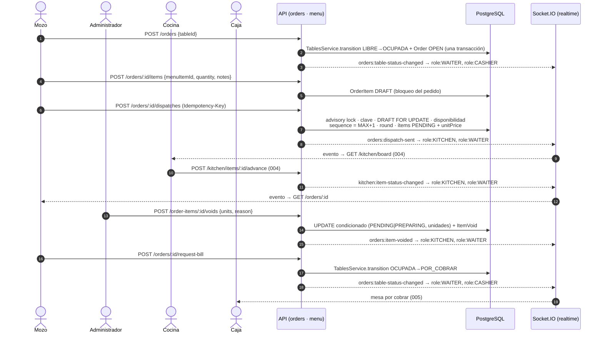

# Implementation Plan: Mesas y pedidos (Módulo 2)

**Branch**: `003-mesas-pedidos` | **Date**: 2026-10-29 | **Spec**: [spec.md](spec.md)

**Input**: Feature specification from `/specs/003-mesas-pedidos/spec.md`

**Note**: This template is filled in by the `/speckit-plan` command; its definition describes the execution workflow.

## Summary

El mozo reemplaza su libreta por la tablet: ve las mesas con su estado, abre una mesa libre,
toma el pedido con la carta disponible (cantidad y nota por plato), lo envía a cocina por
rondas, sigue el estado de cada ítem y pide la cuenta. El administrador anula, total o
parcialmente y con motivo, lo que ya se envió.

Enfoque técnico: un módulo `orders` en NestJS dueño de cuatro tablas nuevas (`Order`,
`OrderItem`, `KitchenDispatch`, `ItemVoid`) con los nombres acordados con la 004. Cambia el
estado de `DiningTable` (de la 002) solo con `TablesService.transition`, dentro de su propia
transacción. Tres decisiones de concurrencia sostienen las garantías de la spec:

- una sola orden `OPEN` por mesa, con una actualización condicionada y un índice único parcial;
- un `sequence` correlativo, único y en el orden de confirmación, con un bloqueo de asesoría de
  transacción;
- envíos idempotentes con `Idempotency-Key`.

Los eventos `orders:*` salen por el gateway de la 001 después del commit. Las pantallas `/mozo`
y `/mozo/pedidos/:orderId` vuelven a consultar la API ante cada evento o reconexión. Sin
dependencias nuevas. Detalle de las decisiones en [research.md](research.md).

## Technical Context

**Language/Version**: TypeScript 5.x en modo estricto; Node.js 22 LTS (igual que la 001).

**Primary Dependencies**: las de la 001: NestJS 11, Prisma 6, Socket.IO 4 y Zod en la API;
React 19, Vite, React Router, TanStack Query, Tailwind CSS y socket.io-client en la web.
**Ninguna dependencia nueva.**

**Storage**: PostgreSQL 17 con Prisma. Una migración de la feature con 4 tablas, 2 enums, un
índice único parcial y restricciones `CHECK` ([data-model.md](data-model.md)). Va después de
`20261029000001_menu_and_tables` y antes de la migración de la 004.

**Testing**: Jest + Supertest + socket.io-client contra PostgreSQL de pruebas en la API,
incluidas las carreras con `Promise.all`; Vitest + React Testing Library + MSW en la web;
Playwright en 768×1024 y 1366×1024 de extremo a extremo; `npm run check:ac -- 003`.

**Target Platform**: tablet del mozo (Chrome/Safari, vertical y horizontal) como dispositivo
principal, y celular; servidor Linux en Docker Compose.

**Project Type**: aplicación web en monorepo; la feature trabaja sobre `apps/api`, `apps/web`
y `packages/shared`.

**Performance Goals**:

- Envío y anulación visibles en cocina, y cambios de mesa e ítem visibles para los mozos, en
  menos de 3 s en el 95 % de los casos (SC-003, SC-004).
- `GET /api/orders/tables` y `GET /api/orders/{id}` en menos de 200 ms (p95).
- `POST …/dispatches` en menos de 500 ms (p95), incluido el bloqueo de envío.

**Constraints**:

- Nada confirmado se pierde ni se duplica ante cortes de conexión (SC-001).
- Los envíos se ordenan exactamente por confirmación (SC-002).
- Sin desplazamiento horizontal en 768–1366 px, áreas táctiles de 44×44 px y confirmación en
  las acciones destructivas.
- No se exige trabajar sin conexión.

**Scale/Scope**: una picantería, 8 a 15 mesas, hasta 5 mozos y unos 60 envíos por servicio.
En esta feature: 2 pantallas, 11 endpoints, 3 eventos emitidos y 4 tablas.

## Constitution Check

*GATE: Must pass before Phase 0 research. Re-check after Phase 1 design.*

| Regla de la constitución | Cómo la cumple este plan | Estado |
|--------------------------|--------------------------|--------|
| **I. TypeScript estricto** | Mismas reglas de la 001 (`strict`, ESLint `strictTypeChecked`). Cuerpos, parámetros y la cabecera `Idempotency-Key` validados con Zod (`packages/shared/src/schemas/orders.ts`); respuestas tipadas con esos esquemas; cargas de eventos tipadas en `ServerToClientEvents`. Las consultas SQL crudas (bloqueos y anulación) tipan su resultado. | ✅ |
| **II. Pruebas de criterios de aceptación** | Los 41 criterios `AC-x.y` tienen capa de prueba asignada (tabla abajo), con títulos `"[003] AC-x.y: …"`. Los avisos de plato listo son criterios de la 004 ([research.md §16](research.md)), así que `check:ac -- 003` debe dar 41/41 sin esperar a otra feature. | ✅ |
| **III. Interfaz en español** | Textos de pantallas, confirmaciones y mensajes en español ([contracts/ui-routes.md](contracts/ui-routes.md)); los 13 códigos de error nuevos con mensaje en `ERROR_MESSAGES`; montos `S/ 0.00` y horas `es-PE`. | ✅ |
| **IV. Tablet para mozo y cocina** | Pruebas Playwright de `/mozo` y `/mozo/pedidos/:orderId` en los dos viewports; utilidad `touch-target` de la 001; sin `hover`; confirmación al quitar, cancelar la apertura, anular, pedir la cuenta y reabrir; estados con texto además del color. Enviar a cocina es un solo toque. | ✅ |
| **Stack** | React + NestJS + PostgreSQL; migración versionada con Prisma (el índice parcial y los `CHECK` van en su `migration.sql`); sin bibliotecas nuevas; sin secretos. | ✅ |
| **Flujo y puertas** | Spec → clarify → plan → tasks → analyze → implement en la rama `003-mesas-pedidos`; PR revisado por el revisor asignado (Paolo). Las puertas se ejecutan con los comandos de [quickstart.md](quickstart.md). | ✅ |

**Resultado previo a Phase 0**: sin violaciones.

**Re-evaluación tras Phase 1**: el diseño mantiene todas las reglas:

- un solo dueño para cada dato (la 003 para el pedido, `menu` para la mesa);
- concurrencia resuelta en la base;
- eventos después del commit y consulta como garantía;
- pantallas de tablet con confirmaciones.

Tras `/speckit-analyze` (2026-10-29), los avisos de plato listo pasaron a ser criterios de la
004. La 003 ya no depende de ella para cumplir la puerta del Principio II, y la 004 puede
empezar sobre la migración de la 003 sin un bloqueo mutuo.

### Asignación de criterios de aceptación a capas de prueba

| Criterios | Capa | Ubicación prevista |
|-----------|------|--------------------|
| AC-1.1, AC-1.2, AC-1.4, AC-1.5, AC-1.6, AC-1.7, AC-1.8, AC-6.1, AC-6.3, AC-6.4, AC-6.6 | API (Jest + Supertest) | `apps/api/test/acceptance/orders-tables.acceptance.spec.ts` |
| AC-2.1, AC-2.2, AC-2.3, AC-2.4, AC-2.5, AC-2.6, AC-2.7, AC-6.2, AC-6.7 | API (Jest + Supertest) | `apps/api/test/acceptance/order-items.acceptance.spec.ts` |
| AC-3.1, AC-3.3, AC-3.4, AC-3.5, AC-3.6, AC-3.7, AC-3.9, AC-3.10 | API (Jest + Supertest) | `apps/api/test/acceptance/dispatches.acceptance.spec.ts` |
| AC-5.1, AC-5.3, AC-5.4, AC-5.5, AC-5.6, AC-5.7 | API (Jest + Supertest) | `apps/api/test/acceptance/voids.acceptance.spec.ts` |
| AC-1.3, AC-3.2, AC-5.2, AC-6.1, AC-6.6 | API + socket.io-client (eventos en menos de 3 s) | `apps/api/test/acceptance/orders-realtime.acceptance.spec.ts` |
| AC-1.1, AC-1.3, AC-1.5, AC-6.5 | Web (Vitest + RTL + MSW) | `apps/web/src/features/orders/TablesBoardPage.test.tsx` |
| AC-2.1, AC-2.6, AC-3.1, AC-3.4, AC-3.5, AC-3.8, AC-4.1, AC-4.2, AC-5.3, AC-6.2, AC-6.3, AC-6.7 | Web (Vitest + RTL + MSW) | `apps/web/src/features/orders/OrderPage.test.tsx` |
| AC-1.2, AC-1.3, AC-3.1, AC-3.8, AC-3.9 | Extremo a extremo (Playwright, tablet, sin conexión simulada) | `apps/web/e2e/waiter.spec.ts` |

AC-6.6 (Caja cobra y la mesa vuelve a libre) se prueba con el ayudante `simulateCashierPayment`,
que hace lo que hará Caja: `TablesService.transition` de `POR_COBRAR` a `LIBRE`, pedido `PAID` y
el evento `orders:table-status-changed`. Se comprueban los datos y que el evento llega a los
mozos. Cuando la 005 exista, su prueba de cobro reemplaza al sustituto (P5 en
[research.md §17](research.md)).

Las carreras de SC-001, SC-002 y SC-008 se prueban con `Promise.all` en `dispatches` y
`orders-tables`. SC-005 y SC-006 se comprueban en el recorrido manual de
[quickstart.md](quickstart.md).

## Architecture

Flujo principal entre mozo, cocina, administrador y caja. Las líneas punteadas son eventos
emitidos después del commit.



**Módulo `orders` (backend)**, importa `MenuModule` y `RealtimeModule`:

- `OrdersService`: tablero de mesas, abrir, detalle, comensales, pedir la cuenta y cancelar la
  apertura.
- `OrderItemsService`: agregar (con la reapertura de una mesa por cobrar), editar y quitar
  borradores.
- `DispatchesService`: el envío idempotente bajo el bloqueo de envío.
- `VoidsService`: la anulación condicionada.
- `order-locks.ts`: `DISPATCH_LOCK_KEY` y `lockOpenOrder`, el bloqueo del pedido con
  `FOR UPDATE` ([research.md §4 y §6](research.md)).
- `order-mapper.ts`: arma las respuestas, con montos `S/` y valores derivados.
- Controladores con `@Roles('WAITER')`; lectura con `@Roles('WAITER', 'CASHIER')`; anulación
  con `@Roles('ADMIN')`. `ADMIN` pasa siempre.

**Frontend**:

- `TablesBoardPage` en `/mozo` (reemplaza el `WaiterHome` provisional) y `OrderPage` en
  `/mozo/pedidos/:orderId`.
- `useOrdersRealtime`: se suscribe a los eventos de [contracts/websocket-events.md](contracts/websocket-events.md)
  con el socket compartido e invalida `['orders']`.
- `pending-dispatch.ts`: guarda la clave de idempotencia por pedido en `sessionStorage`.
- `ConnectionBanner`: indicador de conexión.
- La bandeja de avisos de plato listo es de la 004 y va en `AppShell`.

## Project Structure

### Documentation (this feature)

```text
specs/003-mesas-pedidos/
├── spec.md
├── plan.md              # Este archivo
├── research.md          # Phase 0: decisiones técnicas y desajustes encontrados
├── data-model.md        # Phase 1: entidades, estados y migración
├── quickstart.md        # Phase 1: guía de validación
├── contracts/
│   ├── rest-api.yaml          # OpenAPI de /api/orders y /api/order-items
│   ├── websocket-events.md    # Eventos orders:* y eventos escuchados
│   └── ui-routes.md           # Pantallas /mozo y /mozo/pedidos/:orderId
├── checklists/
│   └── requirements.md
└── tasks.md             # Phase 2 (/speckit-tasks)
```

### Source Code (repository root)

```text
packages/shared/src/
├── events.ts                 # + orders:dispatch-sent, orders:item-voided, orders:table-status-changed y sus cargas
├── errors.ts                 # + 13 códigos (ver contracts/rest-api.yaml) con mensaje en español
├── schemas/orders.ts         # Zod: peticiones, Idempotency-Key, TableOverview, OrderDetail, OrderItem, Dispatch, VoidResult
└── index.ts                  # + export de schemas/orders

apps/api/
├── prisma/
│   ├── schema.prisma         # + Order, OrderItem, KitchenDispatch, ItemVoid, enums; relaciones inversas en User, DiningTable, MenuItem
│   └── migrations/<fecha>_orders/migration.sql   # + índice parcial y CHECK a mano
├── src/
│   ├── orders/
│   │   ├── orders.module.ts
│   │   ├── orders.controller.ts          # tables (antes que :orderId), open, :orderId, patch, items, request-bill, cancel
│   │   ├── dispatches.controller.ts      # POST orders/:orderId/dispatches
│   │   ├── order-items.controller.ts     # PATCH/DELETE order-items/:itemId, POST order-items/:itemId/voids
│   │   ├── orders.service.ts
│   │   ├── order-items.service.ts
│   │   ├── dispatches.service.ts
│   │   ├── voids.service.ts
│   │   ├── order-locks.ts
│   │   ├── order-mapper.ts
│   │   ├── order-mapper.spec.ts          # Unitarias: consumo, unidades vigentes, canCancel/canRequestBill
│   │   └── idempotency-key.decorator.ts  # Lee y valida la cabecera
│   ├── menu/tables.service.ts            # + transition(tx, tableId, from, to)
│   ├── realtime/realtime.gateway.ts      # + emitToRoles (si la 004 no lo agregó antes)
│   └── app.module.ts                     # + OrdersModule
└── test/
    ├── acceptance/
    │   ├── orders-tables.acceptance.spec.ts
    │   ├── order-items.acceptance.spec.ts
    │   ├── dispatches.acceptance.spec.ts
    │   ├── voids.acceptance.spec.ts
    │   └── orders-realtime.acceptance.spec.ts
    └── helpers/
        ├── db.ts                         # resetDb: primero item_voids, order_items, kitchen_dispatches, orders
        └── order-factories.ts            # Mesa, carta, pedido, ítems, envíos y simulateCashierPayment

apps/web/
├── src/
│   ├── lib/api-client.ts                 # + cabeceras opcionales (Idempotency-Key)
│   ├── lib/realtime-context.tsx          # RealtimeProvider + useRealtimeEvent (de la 004; se crea si llega antes)
│   ├── components/ConnectionBanner.tsx   # Compartido con la 004
│   ├── app/router.tsx                    # /mozo → TablesBoardPage; /mozo/pedidos/:orderId → OrderPage
│   └── features/orders/
│       ├── api.ts                        # useTablesBoard, useOrder, useOpenTable, useAddItem, useUpdateItem,
│       │                                 # useRemoveItem, useSendToKitchen, useVoidItem, useRequestBill, useCancelOpening
│       ├── useOrdersRealtime.ts
│       ├── pending-dispatch.ts
│       ├── TablesBoardPage.tsx · TableCard.tsx · OpenTableDialog.tsx
│       ├── OrderPage.tsx · MenuPicker.tsx · DraftItems.tsx · SentItems.tsx
│       ├── ConsumptionSummary.tsx · VoidItemDialog.tsx
│       ├── TablesBoardPage.test.tsx
│       └── OrderPage.test.tsx
├── tests/msw/                            # + manejadores de /api/orders y /api/order-items
└── e2e/
    └── waiter.spec.ts
```

`features/role-home/WaiterHome.tsx` deja de usarse: `/mozo` muestra `TablesBoardPage`. Los
diálogos de confirmación reutilizan `ConfirmDialog` de `features/users/`.

**Structure Decision**: se sigue el patrón de la 001 y la 002. El módulo `orders` es carpeta
hermana de `auth` y `menu` en `apps/api/src/`, y `features/orders/` es hermana de
`features/menu/` en `apps/web/src/`. Archivos de otras features que se tocan, con cambios
pequeños y compatibles:

- de la 002: `tables.service.ts` (método `transition`) y los modelos `DiningTable` y `MenuItem`
  (solo relaciones);
- de la 001: `realtime.gateway.ts`, `api-client.ts`, `router.tsx`, `test/helpers/db.ts` y el
  modelo `User` (solo relaciones).

Los que también plantea la 004 (`emitToRoles`, `realtime-context.tsx`, `ConnectionBanner`)
usan los mismos nombres ([research.md §17](research.md), P6).

## Complexity Tracking

No hay violaciones de la constitución que justificar.
