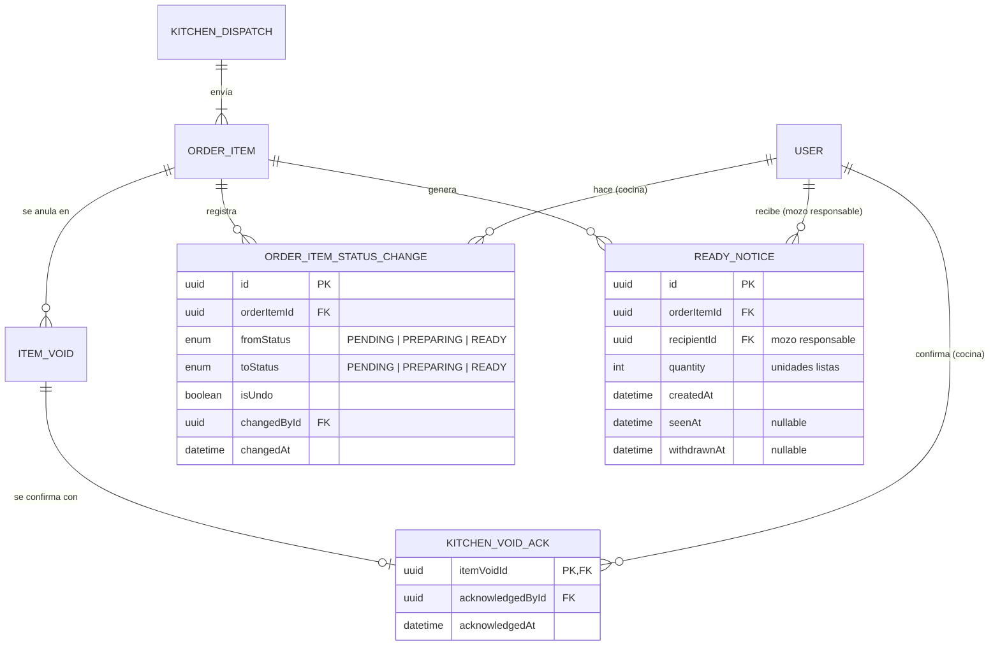
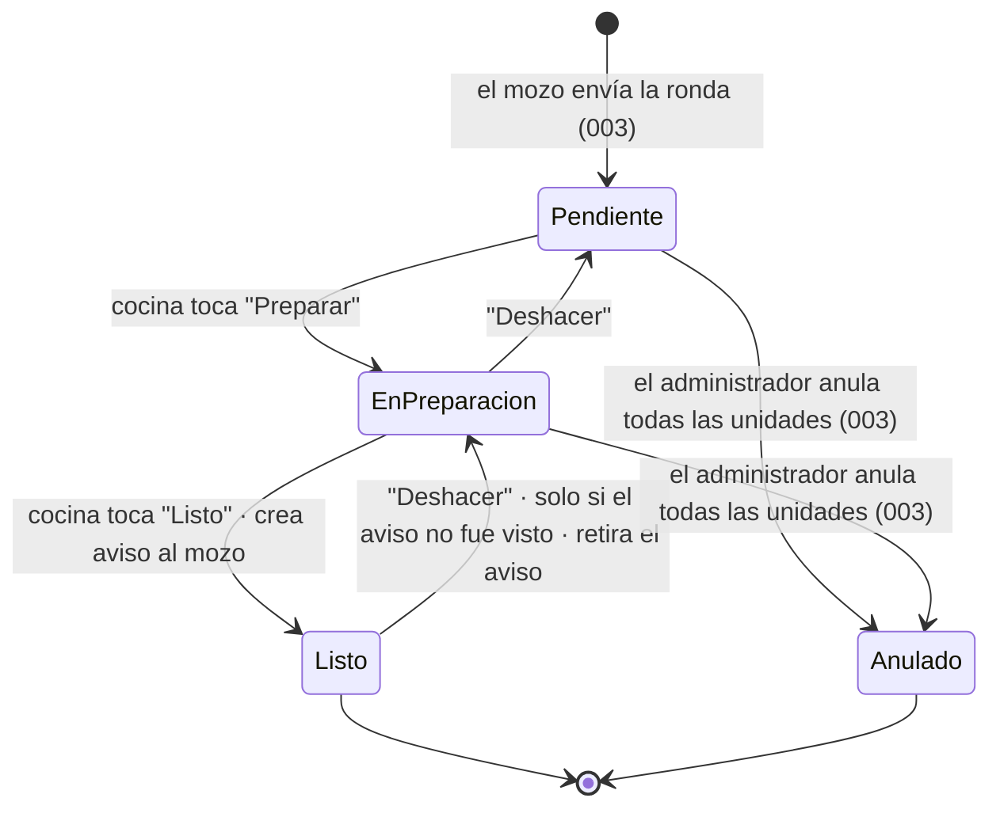

# Data Model: Módulo Cocina — pantalla de comandas

**Feature**: [spec.md](spec.md) | **Plan**: [plan.md](plan.md) | **Date**: 2026-10-29

Cocina no duplica el pedido: lee las entidades de `003-mesas-pedidos` y solo cambia el estado
de los ítems ([research.md §1](research.md)). Este documento tiene dos partes:

1. **Entidades propias de cocina**: tres tablas nuevas, con campos, reglas e índices.
2. **Lo que cocina usa de otras features**: los campos que espera de la 003 (y de la carta),
   como contrato a confirmar con sus dueños ([contracts/dependencias-003.md](contracts/dependencias-003.md)).

Identificadores de código en inglés; etiquetas visibles en español (Principio III).

## Diagrama

Con borde de otras features: `ORDER_ITEM`, `KITCHEN_DISPATCH`, `ITEM_VOID` (003) y `USER` (001).

## 1. Entidades propias de cocina

### OrderItemStatusChange (`order_item_status_changes`)

Historial de cada cambio de estado que hace la cocina. Da la hora de cada cambio (FR-010), la
hora en que se completó una comanda (FR-021) y la trazabilidad de "Deshacer".

| Campo | Tipo | Reglas |
|-------|------|--------|
| `id` | UUID | Generado por el sistema. |
| `orderItemId` | UUID → `OrderItem` (003) | Obligatorio. |
| `fromStatus`, `toStatus` | `OrderItemStatus` | Solo pasos de un nivel: `PENDING↔PREPARING`, `PREPARING↔READY`. |
| `isUndo` | booleano | `true` si el cambio retrocede un paso. |
| `changedById` | UUID → `User` | Usuario de cocina (o administrador) que tocó. |
| `changedAt` | fecha y hora | Automática. |

**Índice**: `(orderItemId, changedAt)`.

### ReadyNotice (`ready_notices`)

Aviso de plato listo para el mozo responsable (FR-015 a FR-018).

| Campo | Tipo | Reglas |
|-------|------|--------|
| `id` | UUID | Generado por el sistema. |
| `orderItemId` | UUID → `OrderItem` | Obligatorio. |
| `recipientId` | UUID → `User` | El mozo responsable de la mesa (`Order.waiterId`) al momento de crearse. |
| `quantity` | entero ≥ 1 | Unidades por preparar del ítem al marcarlo Listo (cantidad − anuladas). |
| `createdAt` | fecha y hora | Automática. |
| `seenAt` | fecha y hora, opcional | Cuando el mozo toca "Visto". |
| `withdrawnAt` | fecha y hora, opcional | Cuando la cocina deshace el "Listo". |

**Invariante**: un ítem tiene como máximo un aviso **abierto** (`seenAt` y `withdrawnAt`
nulos). Se garantiza con un índice único parcial creado en la migración:
`CREATE UNIQUE INDEX ready_notices_open_item ON ready_notices (order_item_id) WHERE seen_at IS NULL AND withdrawn_at IS NULL`.

**Índice**: `(recipientId)` para la consulta de avisos del mozo.

### KitchenVoidAck (`kitchen_void_acks`)

Confirmación "Entendido" de una anulación (FR-024, FR-027).

| Campo | Tipo | Reglas |
|-------|------|--------|
| `itemVoidId` | UUID → `ItemVoid` (003), clave primaria | Una confirmación por anulación; confirmar dos veces no falla (idempotente). |
| `acknowledgedById` | UUID → `User` | Usuario de cocina que tocó "Entendido". |
| `acknowledgedAt` | fecha y hora | Automática. |

## 2. Estados del ítem vistos desde cocina

El enum `OrderItemStatus` lo define la 003. Cocina usa sus valores de enviado
(`PENDING`, `PREPARING`, `READY`, `VOIDED`) y nunca ve los ítems no enviados.

Una anulación **parcial** no cambia el estado: aumenta las unidades anuladas del ítem y crea
un aviso de anulación para cocina.

## 3. Valores derivados (no se guardan)

| Valor | Cálculo |
|-------|---------|
| Unidades por preparar | `OrderItem.quantity − OrderItem.voidedQuantity` |
| Comanda activa | Algún ítem del envío en `PENDING` o `PREPARING` |
| Comanda completada | Todos los ítems no anulados en `READY`; `completedAt` = último cambio a `READY` |
| Comanda anulada | Todos los ítems en `VOIDED`; visible mientras alguna anulación no tenga confirmación |
| En "Completadas" | `completedAt` dentro de los últimos 30 minutos |
| Tiempo de espera | `serverTime − KitchenDispatch.sentAt` (activa) o `completedAt − sentAt` (completada) |
| Nivel de demora | ≥ 15 min "Demorado"; ≥ 25 min "Muy demorado" |
| ¿Se puede deshacer? | Comanda activa o completada hace menos de 30 min; ítem no anulado; si está en `READY`, su aviso no fue visto |

## 4. Lo que cocina usa de otras features

Resumen; el detalle está en [contracts/dependencias-003.md](contracts/dependencias-003.md).

| Entidad (feature) | Campos que usa cocina |
|-------------------|-----------------------|
| `KitchenDispatch` (003) | `id`, `sequence` (correlativo único), `round` (ronda de la mesa), `sentById`, `sentAt`, `orderId` |
| `Order` (003) | `waiterId` (mozo responsable), `tableId` |
| `DiningTable` (003) | `tableNumber` |
| `OrderItem` (003) | `id`, `dispatchId`, `menuItemId`, `quantity`, `voidedQuantity`, `notes`, `status` |
| `ItemVoid` (003) | `id`, `orderItemId`, `units`, `voidedAt` |
| `MenuItem` (002) | `name` |
| `User` (001) | `id`, `fullName` |

## 5. Migración

Una migración Prisma de la feature (`apps/api/prisma/migrations/<fecha>_kitchen/`) crea las
tres tablas, sus claves foráneas (`ON DELETE RESTRICT`, igual que la 001: nada se borra) y el
índice único parcial de `ready_notices`. Debe aplicarse después de la migración de la 003.
