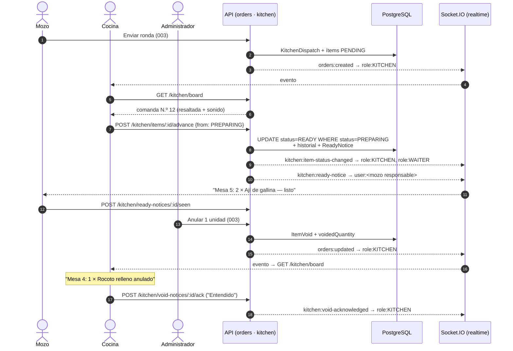

# Implementation Plan: Módulo Cocina — pantalla de comandas

**Branch**: `004-cocina` | **Date**: 2026-10-29 | **Spec**: [spec.md](spec.md)

**Input**: Feature specification from `/specs/004-cocina/spec.md`

**Note**: This template is filled in by the `/speckit-plan` command; its definition describes the execution workflow.

## Summary

La cocina ve en una tablet las comandas en orden de llegada, avanza cada plato de Pendiente a
En preparación y a Listo con un toque, avisa al mozo responsable cuando un plato está listo,
ve el tiempo de espera y se entera de las anulaciones, que confirma con "Entendido".

Enfoque técnico: un módulo `kitchen` en NestJS que **no duplica el pedido**: lee los envíos e
ítems de `003-mesas-pedidos` y solo cambia el estado del ítem, con control de concurrencia
por estado esperado. Guarda en tres tablas propias el historial de estados, los avisos de
plato listo y las confirmaciones de anulación. La pantalla `/cocina` se alimenta de un solo
endpoint (`GET /api/kitchen/board`) y vuelve a consultarlo cada vez que llega un evento por el
canal Socket.IO de la 001, lo que garantiza orden, cero duplicados y recuperación tras un corte.
Sin dependencias nuevas. Detalle de las decisiones en [research.md](research.md).

## Technical Context

**Language/Version**: TypeScript 5.x en modo estricto; Node.js 22 LTS (igual que la 001).

**Primary Dependencies**: las de la 001: NestJS 11, Prisma 6, Socket.IO 4, Zod (api); React 19,
Vite, React Router, TanStack Query, Tailwind CSS, socket.io-client (web). Web Audio API del
navegador para el sonido. **Ninguna dependencia nueva.**

**Storage**: PostgreSQL 17 con Prisma; una migración de la feature con 3 tablas
([data-model.md](data-model.md)). Depende de la migración de la 003.

**Testing**: Jest + Supertest + socket.io-client contra PostgreSQL de pruebas (api); Vitest +
React Testing Library + MSW con relojes falsos (web); Playwright en 768×1024 y 1366×1024
(extremo a extremo); `npm run check:ac -- 004`.

**Target Platform**: tablet en la cocina (Chrome/Safari, vertical y horizontal); celular o
tablet del mozo para los avisos; servidor Linux en Docker Compose.

**Project Type**: aplicación web en monorepo (feature sobre `apps/api`, `apps/web` y
`packages/shared`).

**Performance Goals**: comanda nueva visible en cocina y aviso visible al mozo en menos de
3 s (SC-001, SC-002); `GET /api/kitchen/board` en menos de 300 ms (p95) con 60 envíos del
día; reconexión con tablero correcto en menos de 10 s (SC-006).

**Constraints**: sin desplazamiento horizontal en 768–1366 px; texto de comandas ≥ 18 px;
botones de al menos 44×44 px; el estado se lleva por ítem y solo avanza un paso por toque; un
"Listo" visto no se deshace.

**Scale/Scope**: una picantería, 8–15 mesas, hasta 2 tablets de cocina y 5 mozos. En esta
feature: 1 pantalla (`/cocina`), 1 componente compartido (bandeja de avisos del mozo),
6 endpoints, 4 eventos emitidos y 3 tablas.

## Constitution Check

*GATE: Must pass before Phase 0 research. Re-check after Phase 1 design.*

| Regla de la constitución | Cómo la cumple este plan | Estado |
|--------------------------|--------------------------|--------|
| **I. TypeScript estricto** | Mismas reglas de la 001 (`strict`, ESLint `strictTypeChecked`). Cuerpos de petición validados con Zod (`packages/shared/src/schemas/kitchen.ts`); cargas de eventos tipadas en `ServerToClientEvents`. | ✅ |
| **II. Pruebas de criterios de aceptación** | Los 28 criterios `AC-x.y` tienen capa de prueba asignada (tabla abajo); títulos `"[004] AC-x.y: …"`; `check:ac -- 004` se agrega al CI al empezar la implementación. | ✅ |
| **III. Interfaz en español** | Textos de pantalla y avisos en español; errores nuevos con mensaje en `ERROR_MESSAGES`; horas con `es-PE`. | ✅ |
| **IV. Tablet para mozo y cocina** | Pruebas Playwright de `/cocina` y de la bandeja del mozo en ambos viewports; clases `touch-target` (44 px) y `text-kitchen` (≥ 18 px) de la 001; sin `hover`; "Deshacer" pide confirmación; demoras con texto además del color (contraste AA). | ✅ |
| **Stack** | React + NestJS + PostgreSQL; migración versionada con Prisma; sin bibliotecas nuevas; sin secretos. | ✅ |
| **Flujo y puertas** | Spec → clarify → plan → tasks → analyze → implement en la rama `004-cocina`, un PR al final revisado por el responsable de la 003. | ✅ |

**Resultado previo a Phase 0**: sin violaciones.
**Re-evaluación tras Phase 1**: el diseño (estado único en el ítem de la 003, tablero como
fuente de verdad, avisos derivados de datos) mantiene todas las reglas en ✅. AC-2.7 se ajustó
para usar el mensaje de permiso de la 001 ([research.md §10](research.md)).

### Asignación de criterios de aceptación a capas de prueba

| Criterios | Capa | Ubicación prevista |
|-----------|------|--------------------|
| AC-1.2, AC-1.4, AC-1.5, AC-1.6, AC-1.7, AC-2.4, AC-4.3, AC-5.1, AC-5.2, AC-5.3, AC-5.4 | API (Jest + Supertest) | `apps/api/test/acceptance/kitchen-board.acceptance.spec.ts` |
| AC-2.1, AC-2.2, AC-2.3, AC-2.5, AC-2.7, AC-2.8 | API (Jest + Supertest) | `apps/api/test/acceptance/kitchen-items.acceptance.spec.ts` |
| AC-3.2, AC-3.3, AC-3.4, AC-3.5 | API (Jest + Supertest) | `apps/api/test/acceptance/ready-notices.acceptance.spec.ts` |
| AC-2.6, AC-3.1, AC-3.5, AC-5.5 | API + socket.io-client | `apps/api/test/acceptance/kitchen-realtime.acceptance.spec.ts` |
| AC-1.1, AC-1.3, AC-1.4, AC-2.5, AC-4.1, AC-4.2, AC-5.1, AC-5.2, AC-5.5 | Web (Vitest + RTL + MSW) | `apps/web/src/features/kitchen/KitchenBoardPage.test.tsx` |
| AC-3.1, AC-3.2 | Web (Vitest + RTL + MSW) | `apps/web/src/features/kitchen/ready-notices/ReadyNoticesTray.test.tsx` |
| AC-1.3, AC-2.6, AC-3.1 | Extremo a extremo (Playwright, tablet) | `apps/web/e2e/kitchen.spec.ts` |

## Architecture

Flujo principal entre mozo, cocina y administrador. Cocina solo escribe el estado del ítem y
sus tablas propias; el envío y la anulación los registra la 003.



**Módulo `kitchen` (backend)**:

- `KitchenBoardService` arma el tablero: comandas activas por `sequence`, completadas de los
  últimos 30 minutos, anulaciones sin confirmar y `serverTime`.
- `KitchenItemsService` hace los pasos y "Deshacer" en una transacción: actualización
  condicionada por estado, historial y crear o retirar el aviso. Después emite los eventos.
- `ReadyNoticesService` atiende los avisos del mozo ("Visto").
- Los controladores usan `@Roles(Role.KITCHEN)` (tablero, ítems, anulaciones) y
  `@Roles(Role.WAITER)` (avisos); `ADMIN` pasa siempre.

**Frontend**:

- `KitchenBoardPage` en `/cocina` reemplaza el `KitchenHome` provisional de la 001.
- `ReadyNoticesTray` se monta en `AppShell` para el rol mozo.
- Ambos usan el socket compartido de `RealtimeContext` ([research.md §7](research.md)).

## Project Structure

### Documentation (this feature)

```text
specs/004-cocina/
├── spec.md
├── plan.md              # Este archivo
├── research.md          # Phase 0: decisiones técnicas
├── data-model.md        # Phase 1: tablas propias y campos usados de la 003
├── quickstart.md        # Phase 1: guía de validación
├── contracts/
│   ├── rest-api.yaml          # OpenAPI de /api/kitchen
│   ├── websocket-events.md    # Eventos kitchen:* y eventos escuchados de la 003
│   └── dependencias-003.md    # Lo que cocina necesita de mesas y pedidos
├── checklists/
│   └── requirements.md
└── tasks.md             # Phase 2 (/speckit-tasks)
```

### Source Code (repository root)

```text
packages/shared/src/
├── events.ts                 # + eventos kitchen:* y sus cargas
├── errors.ts                 # + ITEM_STATE_CONFLICT, ITEM_VOIDED, READY_ALREADY_SEEN, UNDO_NOT_ALLOWED
└── schemas/kitchen.ts        # Zod: AdvanceItem, UndoItem, KitchenBoard, Ticket, TicketItem, VoidNotice, ReadyNotice

apps/api/
├── prisma/
│   ├── schema.prisma         # + OrderItemStatusChange, ReadyNotice, KitchenVoidAck
│   └── migrations/20261029000003_kitchen/migration.sql
├── src/
│   ├── kitchen/
│   │   ├── kitchen.module.ts
│   │   ├── kitchen.controller.ts         # board, items/:id/advance, items/:id/undo, void-notices/:id/ack
│   │   ├── ready-notices.controller.ts   # ready-notices, ready-notices/:id/seen
│   │   ├── kitchen-rules.ts              # Reglas puras: pasos, ventana de 30 min, estado de la comanda
│   │   ├── kitchen-rules.spec.ts         # Unitarias de las reglas
│   │   ├── kitchen-board.service.ts
│   │   ├── kitchen-items.service.ts
│   │   ├── ready-notices.service.ts
│   │   ├── void-notices.service.ts       # "Entendido" de anulaciones
│   │   └── params.ts                     # UuidParamPipe con mensaje de "no existe"
│   └── realtime/realtime.gateway.ts      # + emitToUser (emitToRoles ya lo agregó la 003)
└── test/
    ├── acceptance/
    │   ├── kitchen-board.acceptance.spec.ts
    │   ├── kitchen-items.acceptance.spec.ts
    │   ├── ready-notices.acceptance.spec.ts
    │   └── kitchen-realtime.acceptance.spec.ts
    └── helpers/kitchen-factories.ts      # Mesa, pedido, envío, ítems y anulaciones de prueba

apps/web/
├── src/
│   ├── lib/realtime-context.tsx          # RealtimeProvider + useRealtimeEvent (ya lo agregó la 003)
│   ├── components/ConnectionBanner.tsx   # + mensaje propio de cocina (componente de la 003)
│   ├── app/AppShell.tsx                  # Proveedor de tiempo real también en el encabezado + <ReadyNoticesTray />
│   ├── app/router.tsx                    # /cocina → KitchenBoardPage
│   └── features/kitchen/
│       ├── api.ts                        # useKitchenBoard, useAdvanceItem, useUndoItem, useAcknowledgeVoid
│       ├── KitchenBoardPage.tsx
│       ├── TicketCard.tsx · TicketItemRow.tsx · WaitBadge.tsx
│       ├── VoidNoticesBar.tsx · CompletedSection.tsx
│       ├── useNewTicketAlert.ts · sound.ts · useServerClock.ts
│       ├── KitchenBoardPage.test.tsx
│       └── ready-notices/
│           ├── api.ts · ReadyNoticesTray.tsx · ReadyNoticesTray.test.tsx
├── tests/msw/kitchen-handlers.ts         # Datos y manejadores MSW de /api/kitchen
└── e2e/kitchen.spec.ts

.github/workflows/ci.yml                  # check:ac -- 001 002 004
```

**Structure Decision**: se sigue el patrón de la 001: el módulo `kitchen` es carpeta hermana de
`auth` en `apps/api/src/`, y `features/kitchen/` es carpeta hermana de `features/auth/` en
`apps/web/src/`. Los únicos archivos de la 001 que se tocan son `realtime.gateway.ts`,
`useRealtime.ts`, `AppShell.tsx` y `router.tsx`, con cambios pequeños que se coordinan con su
dueño.

## Complexity Tracking

No hay violaciones de la constitución que justificar.
