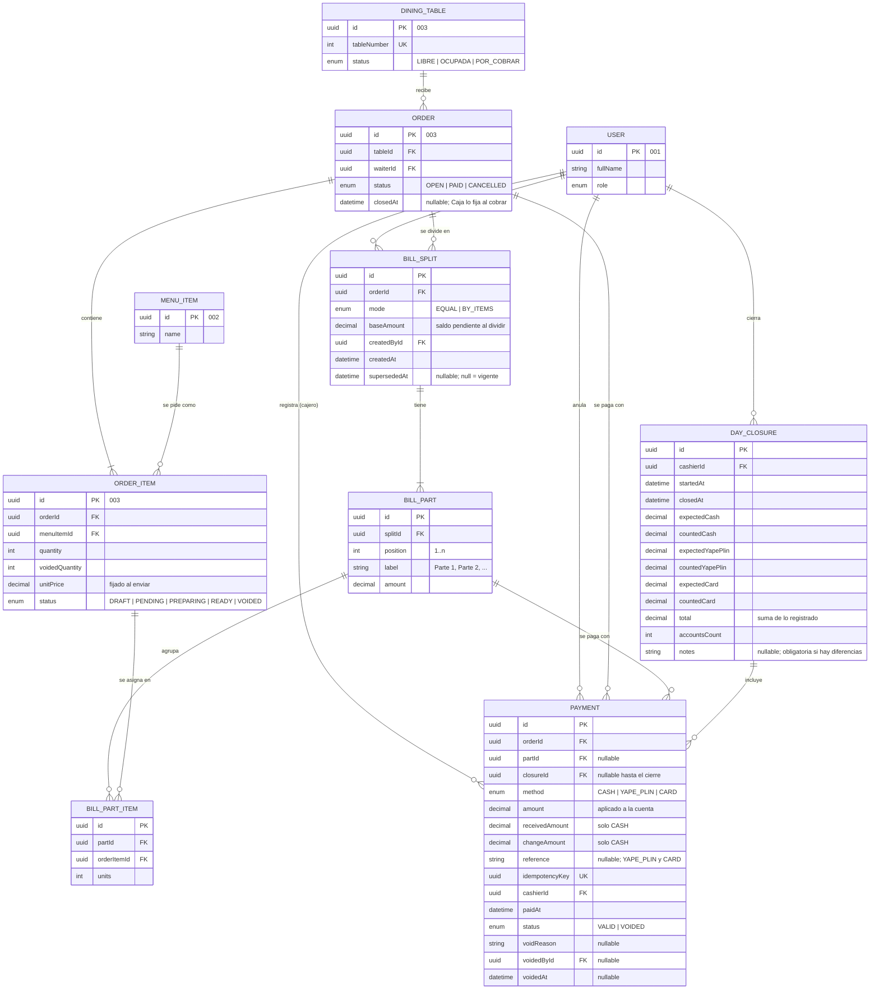
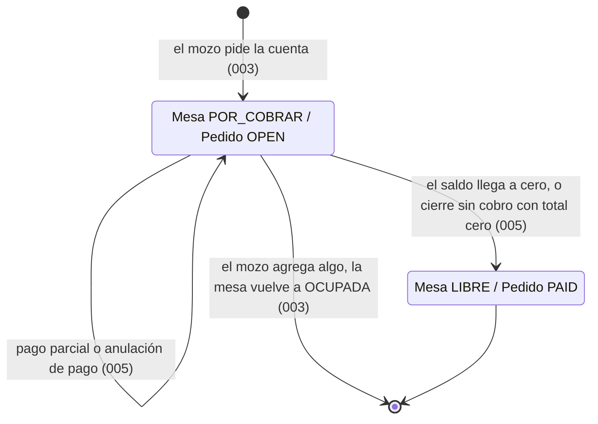
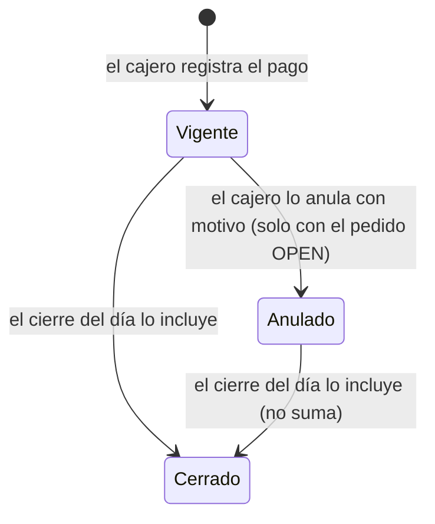

# Data Model: Caja y reportes

**Feature**: [spec.md](spec.md) | **Plan**: [plan.md](plan.md) | **Date**: 2026-10-29

Caja agrega cinco entidades (`Payment`, `BillSplit`, `BillPart`, `BillPartItem`, `DayClosure`)
y reutiliza sin modificar las de la 003 ([003 data-model](../003-mesas-pedidos/data-model.md)).
La "cuenta" no es una tabla: se calcula a partir del pedido ([research.md §2](research.md)).

## 1. Diagrama entidad-relación

Las entidades de la 003 y la 001 aparecen solo con los campos que Caja usa.

## 2. Valores derivados (no se guardan)

| Valor | Cálculo | Fuente |
|-------|---------|--------|
| Total de la cuenta | `consumptionCents` de los ítems del pedido (enviados, no `VOIDED`, unidades vigentes × `unitPrice`) | 003 `order-mapper.ts` |
| Pagado | Σ `Payment.amount` con `status = VALID` del pedido | Caja |
| Saldo pendiente | Total − Pagado | Caja |
| Parte pagada | Σ pagos vigentes con ese `partId` ≥ `BillPart.amount` | Caja |
| División desactualizada (`isStale`) | `BillSplit.baseAmount` + pagos vigentes que no son de sus partes ≠ total actual (cambió el total, o se registró o anuló un pago fuera de la división) | Caja ([research.md §6](research.md)) |
| Unidades pagadas de un ítem (`paidUnits`) | Σ unidades de `BillPartItem` en partes pagadas (de cualquier división del pedido) | Caja |
| Diferencia del cierre por método | `counted − expected` (positivo = sobrante, negativo = faltante) | Caja |

## 3. Entidades nuevas

### Payment

| Campo | Reglas |
|-------|--------|
| `method` | `CASH` (Efectivo), `YAPE_PLIN` (Yape/Plin), `CARD` (Tarjeta). |
| `amount` | > 0 y ≤ saldo pendiente (FR-007). Si `partId` está presente, ≤ lo que falta de esa parte. |
| `receivedAmount`, `changeAmount` | Obligatorios solo en `CASH`: `receivedAmount ≥ amount` (FR-006), `changeAmount = receivedAmount − amount`. Nulos en otros métodos. |
| `reference` | Opcional, hasta 40 caracteres, solo en `YAPE_PLIN` y `CARD`. |
| `idempotencyKey` | UUID único enviado en la cabecera `Idempotency-Key`. |
| `status` | `VALID` al crear. Pasa a `VOIDED` con `voidReason` (3 a 200 caracteres), `voidedById` y `voidedAt`, solo mientras el pedido siga `OPEN` (FR-014). |
| `closureId` | Nulo hasta que un cierre lo incluye; después no cambia (FR-019). |

Restricciones en la migración: `CHECK (amount > 0)`; `CHECK ((method = 'CASH') = (received_amount IS NOT NULL))`;
`CHECK (received_amount IS NULL OR received_amount >= amount)`. Índices: `(order_id, status)`,
`(closure_id)`, `(paid_at)`.

### BillSplit, BillPart y BillPartItem

- Un pedido tiene a lo sumo una división vigente: índice único parcial
  `bill_splits_one_active_per_order ON (order_id) WHERE superseded_at IS NULL`.
- `EQUAL`: entre 2 y 20 partes; montos según [research.md §6](research.md); sin `BillPartItem`.
- `BY_ITEMS`: entre 2 y 20 partes; cada `BillPartItem.units ≥ 1`; por cada ítem, la suma de
  unidades asignadas en la división = unidades vigentes no pagadas del ítem; una parte sin
  ítems no es válida.
- `Σ BillPart.amount = BillSplit.baseAmount` (se verifica al crear).

### DayClosure

- `startedAt` = `closedAt` del cierre anterior, o `paidAt` del primer pago si no hay cierres.
- `expected*` = Σ pagos `VALID` del método con `closureId` nulo al confirmar.
- `counted*` ≥ 0, con 2 decimales.
- `notes` obligatoria (5 a 300 caracteres) si alguna diferencia ≠ 0 (FR-018).
- Inmutable una vez creado (FR-019).

## 4. Transiciones de estado que produce Caja

Caja solo ejecuta las transiciones que la 003 le asigna ([003 data-model](../003-mesas-pedidos/data-model.md)):

